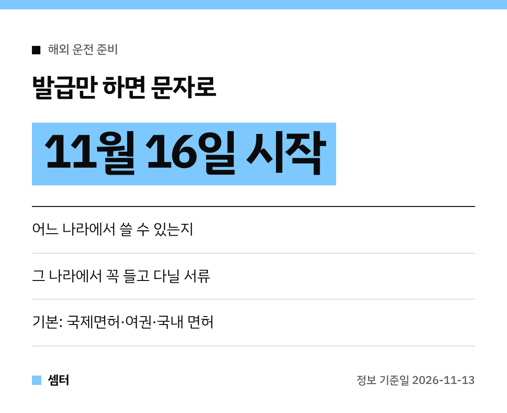

해외에서 직접 운전하는 여행, 요즘 많이들 하시죠~ 🙂
그런데 나라마다 챙길 서류가 달라서 은근히 헷갈렸잖아요.

**11월 16일부터**는 국제운전면허증을 발급받으면 그 정보가 문자로 온대요!

## 이전엔 이렇게 찾아야 했어요
사용 가능한 나라는 한국도로교통공단 누리집에서 확인하고, 운전 주의사항은 대사관 누리집이나 현지 기관에서 따로 알아봐야 했어요.
두세 군데를 돌아다녀야 했던 거죠.

## 이제 문자 한 통으로
국제운전면허증 발급자에게 이런 내용을 보내 줘요.

1. 국제운전면허증을 쓸 수 있는 나라와 주의사항
2. 그 나라에서 운전할 때 꼭 들고 다닐 서류
3. 해외 운전 참고 정보

## 체크리스트로 정리하면
기본 3종 세트는 **국제운전면허증 · 여권 · 국내 운전면허증**이에요.
그다음 문자로 받은 나라별 추가 서류를 하나씩 체크하면 돼요 ✔️

현지에서 서류가 없으면 불이익을 받을 수 있으니, 출국 전에 꼭 한 번 맞춰 보세요.

## 어디서 하는 서비스?
재외동포청·경찰청·한국도로교통공단 세 곳이 함께 만들었어요.
궁금한 건 재외동포청 재외동포서비스지원센터(02-6399-7155)나 경찰청 교통기획과(02-3150-2253)로 물어보면 돼요.

즐거운 여행 되시구! 오늘도 좋은 하루 보내세요~ㅎㅎ
