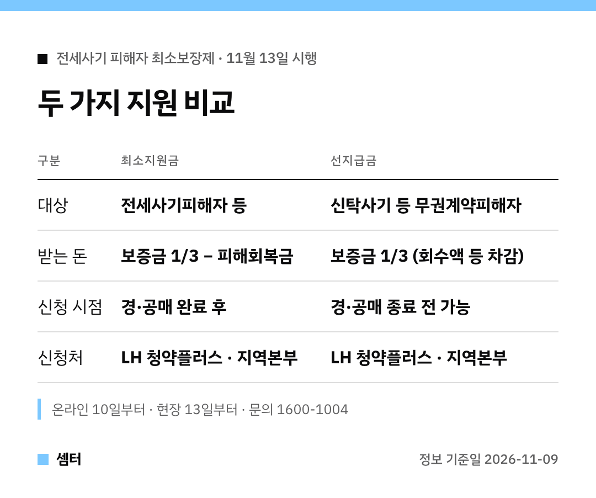

경매가 끝났는데 돌려받은 돈이 너무 적어서 막막하셨던 분들 계시죠.
이번 제도는 바로 그런 분들을 위한 거예요 🙂

한 줄 요약하면, **보증금의 3분의 1까지는 국가가 채워 준다**는 거예요.

## 시행 날짜와 신청 날짜
제도는 11월 13일 시행이에요.
온라인 신청은 그보다 빠른 10일부터 LH 청약플러스에서 받아요.

LH 지역본부를 직접 찾아가는 현장 신청은 13일부터예요.

## 최소지원금 계산해 보기
공식은 '보증금의 3분의 1 − 피해회복금'이에요.
피해회복금은 아래를 다 합친 금액이에요.

- 경매 배당액
- 임대인 등에게서 회수·변제받은 돈
- 경매차익 지원액
- 임대료 재정지원액

이 합계가 보증금의 3분의 1보다 적을 때만 차액이 나와요.

## 지원 대상 체크
특별법으로 결정된 전세사기피해자가 기본 대상이에요.
보증금이 5억 원 이하이고 전입신고·확정일자를 갖춰 피해자 등으로 인정된 임차인도 들어가요.

## 신탁사기는 '선지급-후정산'
적법한 임대 권한이 없는 사람과 계약했다면 무권계약 피해자예요.
이 경우 집 처분이 끝나기 전이라도 보증금 3분의 1을 먼저 받고, 나중에 정산해요.

## 결과 통지와 이의신청
LH는 신청일부터 90일 안에 지급 여부를 결정해 알려 줘요(보완 필요 시 30일 연장).
결정에 이의가 있으면 통지받은 날부터 30일 안에 신청할 수 있어요.

자세한 내용은 LH 청약플러스 공고문이나 LH 콜센터(1600-1004)에서 확인해 보세요 😊

하루빨리 일상 되찾으시구! 오늘도 좋은 하루 보내세요~ㅎㅎ
