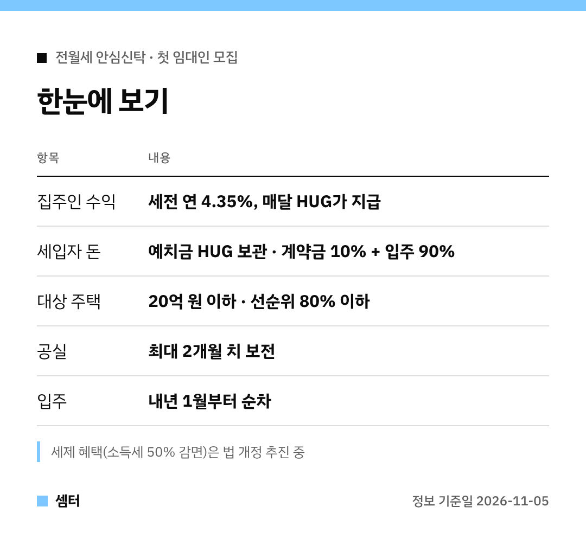

"전세 들어가자니 무섭고, 월세는 부담되고…" 이런 고민 하셨던 분들 주목이요 🙂

정부가 새로운 계약 방식인 **전월세 안심신탁**을 꺼냈어요.
국토부와 HUG가 11월 4일 첫 임대인 모집을 시작했답니다.

## 한 줄로 말하면?
세입자 돈은 HUG가 들고 있고, 집주인 월세는 HUG가 대신 내 주는 구조예요.

법적으로는 '보증금 없는 월세' 계약이에요.
보증금이 집주인 손을 거치지 않으니 전세사기가 원천적으로 막히는 거죠.

## 집주인 입장
- 이번 공고 기준 세전 연 4.35%를 매달 받아요
- 연체 걱정이 없어요
- 다음 세입자도 안심신탁으로 받으면 공실 최대 2개월 치를 보전해 줘요

## 세입자 입장
- 예치금은 압류·경매가 나도 HUG가 100% 반환해요
- 계약갱신청구권, 5% 증액 제한, 대항력이 그대로예요
- 전세보증보험 따로 안 들어도 돼요

예치금은 계약할 때 10%, 들어갈 때 90%로 나눠 내요.

## 참여 조건
소득이나 자산은 안 봐요.
집값 20억 원 이하, 선순위 부채비율 80% 이하인 집이면 유형 상관없이 돼요.

예치금은 적정 전세 시세를 넘을 수 없어요.

## 꼭 알아 둘 점
월세 소득세 50% 감면 같은 세금 혜택은 아직 **확정이 아니에요**.
법을 고쳐야 해서 2028년 5월 신고 전까지 개정을 추진한대요.

지금 사는 세입자가 있다면, 기존 계약을 끝내고 보증금을 돌려준 뒤에야 참여할 수 있어요.

## 신청
안심전세포털(khug.or.kr/jeonse)이나 HUG 지사에서 상시 신청할 수 있어요.
입주는 내년 1월부터 순서대로예요.

다들 안전한 집 계약하시구! 오늘도 좋은 하루 보내세요~ㅎㅎ
