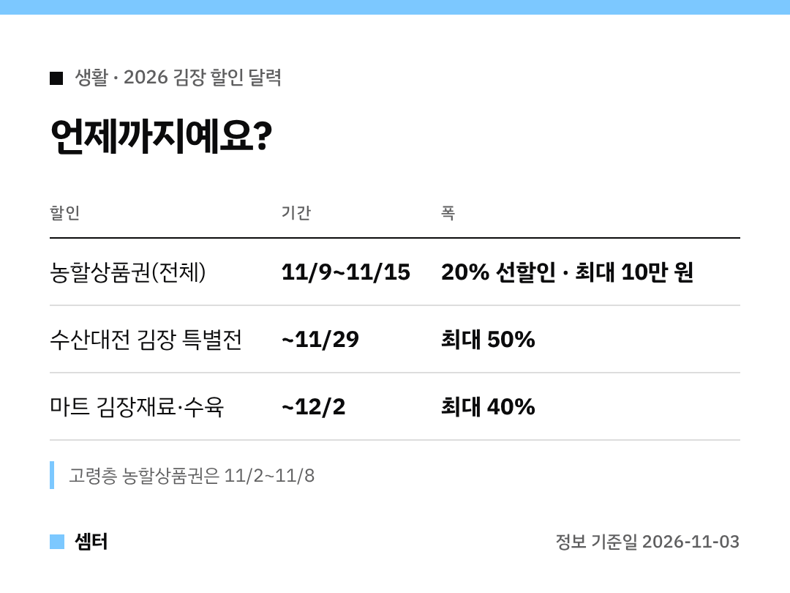

김장, 재료값이 제일 부담이죠~
올해 할인은 **기간이 다 달라서** 날짜순으로 정리해 봤어요 🙂

## 가장 먼저 챙길 것: 농할상품권 (11월 9~15일)
전통시장에서 쓸 수 있는 상품권을 20% 할인된 값에 사는 거예요.
일반 소비자는 **11월 9일부터 15일까지**, 할인 한도는 최대 10만 원이에요.

고령층은 이보다 앞선 11월 2~8일에 먼저 살 수 있어요.

## 젓갈·굴은 11월 29일까지
수산대전 김장 특별전에서 새우젓, 멸치액젓, 천일염, 굴을 **최대 50%** 할인해요.
양념류 중 새우젓은 생산이 줄었다고 하니, 할인 기간에 미리 사 두는 게 좋겠어요!

## 배추·무·수육은 12월 2일까지
대형·중소형마트에서 김장재료 전 품목과 수육용 돼지고기를 최대 40% 할인해요.
오이·애호박·토마토 같은 채소도 할인 대상에 들어간대요.

## 올해 배추값 걱정은?
김장용 가을배추 생산이 작년보다 18.5% 늘 전망이에요.
정부도 배추 4만 6500톤, 무 9000톤을 미리 확보해 뒀대요.

## 우리 집은 얼마나 담글까?
4인 가구 평균은 23.4포기래요.
직접 담그는 집은 58.6%로 작년보다 조금 줄었고요.

## 원산지·농약도 점검해요
수입김치·양념채소 원산지 거짓표시를 12월 5일까지 단속하고, 채소류 잔류농약 검사도 한대요.

다들 김장 무사히 끝내시구! 오늘도 좋은 하루 보내세요~ㅎㅎ
