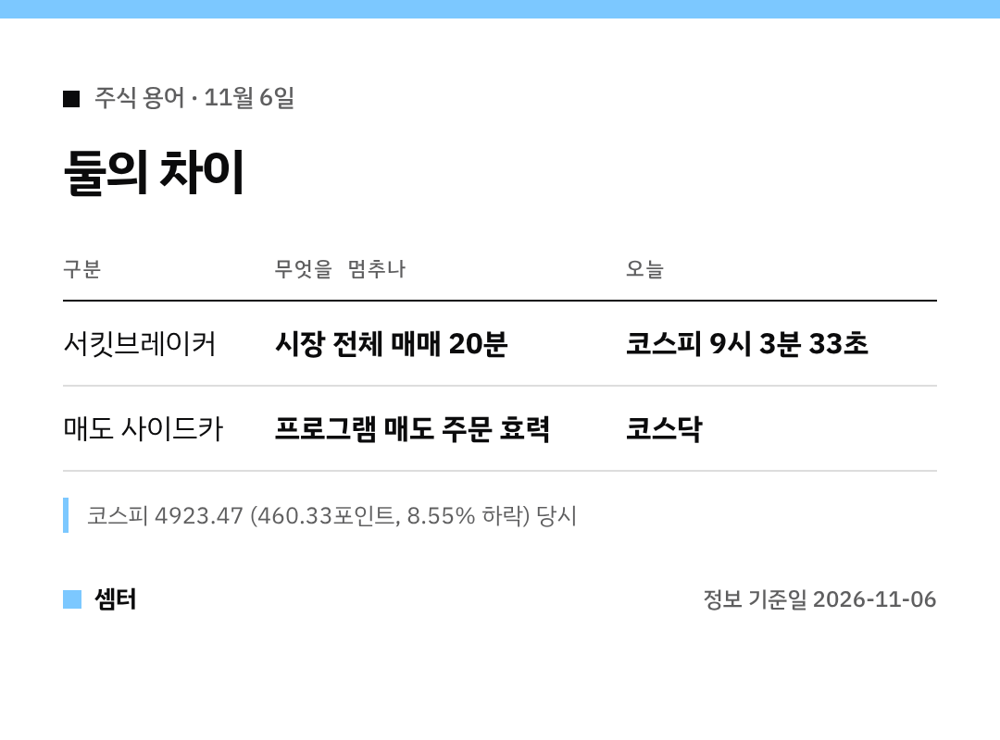

"서킷브레이커? 사이드카? 오늘 주식 왜 멈췄어요?" 하신 분들 위해 짧게 정리했어요 🙂

## 서킷브레이커 3줄 요약
1. 지수가 전일 종가보다 8% 이상 떨어진 채 1분이 지나면
2. 그 뒤 20분 동안 매매가 멈추고
3. 20분 뒤 다시 거래가 시작돼요

## 오늘 상황
11월 6일 오전 9시 3분 33초, 유가증권시장에 서킷브레이커가 걸렸어요.
당시 코스피는 4923.47로, 전날보다 460.33포인트(8.55%) 빠진 상태였어요.

간밤 미국 반도체주 급락이 국내 시장까지 번진 거래요.

## 사이드카랑 뭐가 달라요?
사이드카는 시장 전체가 아니라 프로그램 매도 주문만 잠깐 멈춰요.
오늘은 코스닥에 매도 사이드카가 발동됐어요.

## 마무리 팁
거래가 멈춘 동안엔 주문이 체결되지 않아요.
재개 직후 변동이 클 수 있으니 차분하게 지켜보세요~

다들 침착하게 하루 보내시구! 오늘도 좋은 하루 보내세요~ㅎㅎ
