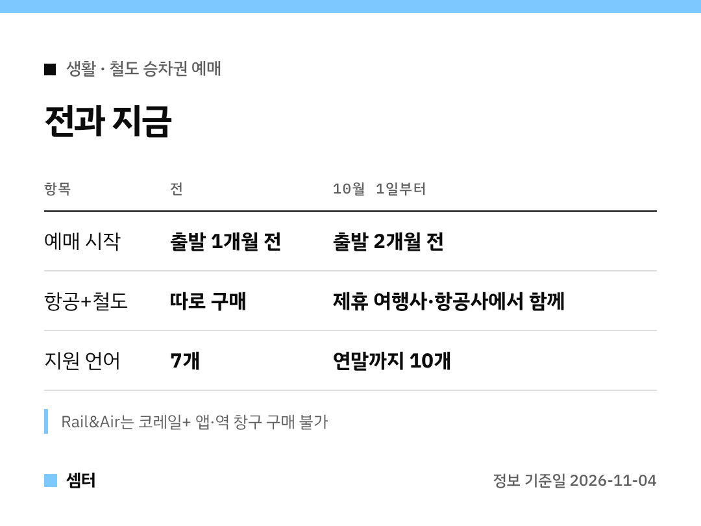

"기차표는 한 달 전에 열린다"고 기억하고 계셨다면, 이제 바꾸셔야 해요ㅎㅎ
**두 달 전**부터 예매가 돼요 🙂

## 한 줄 정리
10월 1일부터 KTX 등 철도 승차권은 출발 **2개월 전**부터 살 수 있어요.

## 겨울 여행이라면 지금이 타이밍
12월~1월은 연말연시와 방학이 겹치는 성수기잖아요.
두 달 전에 미리 열리니까, 원하는 시간대 좌석부터 먼저 잡아 두세요!

숙소나 여행 동선은 기차표에 맞춰 천천히 짜도 돼요.

## 비행기+기차 한 번에 사는 법
'철도-항공(Rail&Air) 연계 서비스'로 항공권을 사면서 공항철도·KTX 표까지 함께 결제할 수 있어요.

주의할 점은 하나예요.
코레일+ 앱, 레츠코레일, 역 창구에서는 안 되고 **제휴 여행사나 항공사**에서만 돼요.

## 외국인 관광객 편의도
예매 화면 언어가 연말까지 10개로 늘고, 위챗페이·알리페이 결제도 준비하고 있대요.

다들 여유 있게 표 잡으시구! 오늘도 좋은 하루 보내세요~ㅎㅎ
