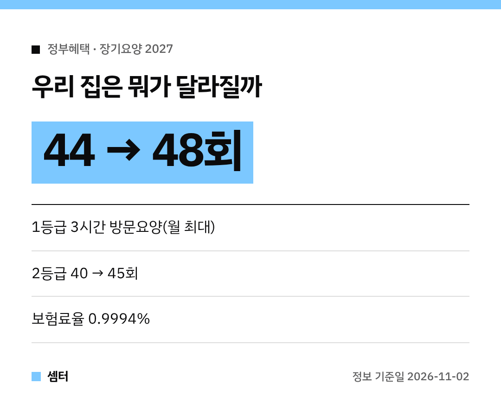

집에서 어르신을 모시는 가족이라면 제일 궁금한 게 "방문요양 몇 번까지 되지?"일 거예요.
내년 숫자가 나왔어요~ 10월 30일 장기요양위원회에서 의결된 내용이라 **확정**이에요 🙂

## 등급별로 먼저 볼게요
1·2등급 중증 어르신은 집에서 쓰는 한도액이 시설급여 최대 이용료의 **100% 수준**까지 올라가요.
덕분에 3시간 방문요양 횟수가 늘어나요.

- **1등급**: 월 최대 44회 → **48회**
- **2등급**: 월 40회 → **45회**
- 등급별 월 한도액은 **2만 3880원~37만 8500원** 올라요

한도액 인상은 주야간보호, 단기보호, 방문요양, 방문목욕, 방문간호 모두에 적용돼요.

## 이용할 때 체감되는 변화
방문간호는 기관이 받는 가산액이 방문당 5000원으로 오르지만, **본인부담금은 늘지 않아요**.
이건 이용하는 쪽에선 반가운 부분이죠!

여러 서비스를 한 기관에서 묶어 받는 통합재가기관은 **700곳**까지 늘고요.
재택의료센터는 **500곳**이 된대요.
24시간 대응 기능을 강화한 거점 재택의료센터도 지정할 계획이래요.

혼자 사시는 어르신이라면 **정기순회·수시대응형** 시범사업도 눈여겨보세요.
하루에 짧게 여러 번 들러 식사·복약을 돕고, 요청하면 추가 방문도 해 주는 방식이에요.

단기보호시설이 부족한 지역에선 우수 등급 요양시설이 정원의 5% 안에서 단기돌봄을 할 수 있게 하는 특례도 추진해요.

## 내 장기요양보험료 계산법
장기요양보험료 = **건강보험료 × 13.90%** 예요.

| 건강보험료(월) | 장기요양보험료(월) |
|---|---|
| 10만 원 | 1만 3900원 |

소득 대비 보험료율은 **0.9994%**(올해 0.9448%)로 정해졌어요.
세대당 월평균으로는 **약 1100원** 오른 2만 129원 정도예요.

## 일하시는 분들 처우도
종일방문요양 수가가 20만 6030원으로 오르고, 유급휴일 가산율은 60%로 높아져요.
섬·벽지 원거리 교통비도 전 구간 30% 올린대요.

병원 가는 길을 도와주는 병원동행 시범사업도 참여기관이 늘어난대요.
짧게 정리하면, 집에서 더 오래 지내실 수 있게 돕는 쪽으로 바뀌는 거예요!

문의는 보건복지부 요양보험제도과(044-202-3499)예요.

다들 부모님 건강 잘 챙기시구! 오늘도 좋은 하루 보내세요~ㅎㅎ
