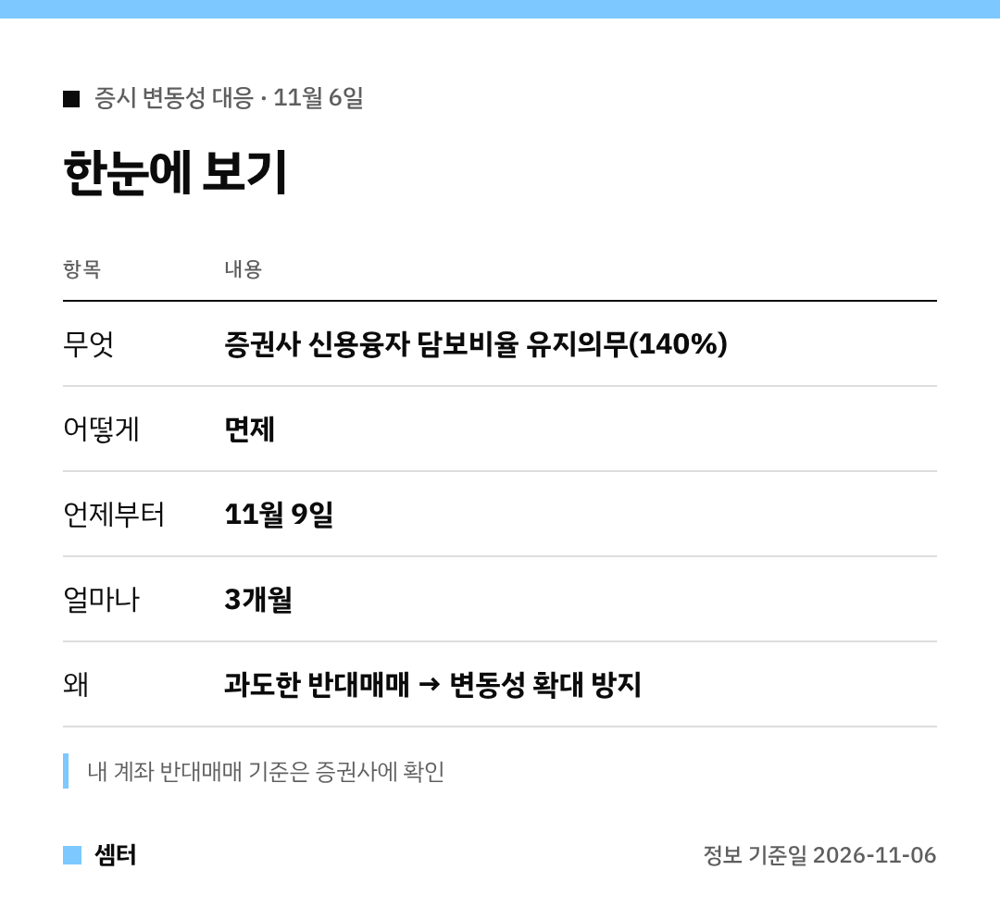

"신용 쓴 계좌, 반대매매 안 당하나요?" 하는 분들 많으시죠 🙂

정부가 증권사 신용융자 규칙 하나를 잠시 풀어 주기로 했어요.

## 핵심 한 줄
증권사가 지켜야 하던 신용융자 담보비율 140% 유지의무를, 11월 9일부터 3개월 동안 면제해요.

## 배경
주가가 급하게 빠지면 반대매매 물량이 쏟아지고, 그게 다시 하락을 키워요.
이 고리를 끊어 보려는 조치예요.

11월 6일 부총리가 주재한 관계기관 합동 점검회의에서 정해졌어요.

## 오해하면 안 되는 점
의무가 면제된다고 반대매매가 사라지는 건 아니에요.
증권사마다 계약 조건이 있으니, 내 계좌 담보비율 기준은 직접 확인해야 해요.

## 앞으로
정부는 변동성이 더 커지면 추가 조치도 하겠다고 했어요.
새 소식 나오면 또 정리해 드릴게요~

다들 침착하게 대응하시구! 오늘도 좋은 하루 보내세요~ㅎㅎ
