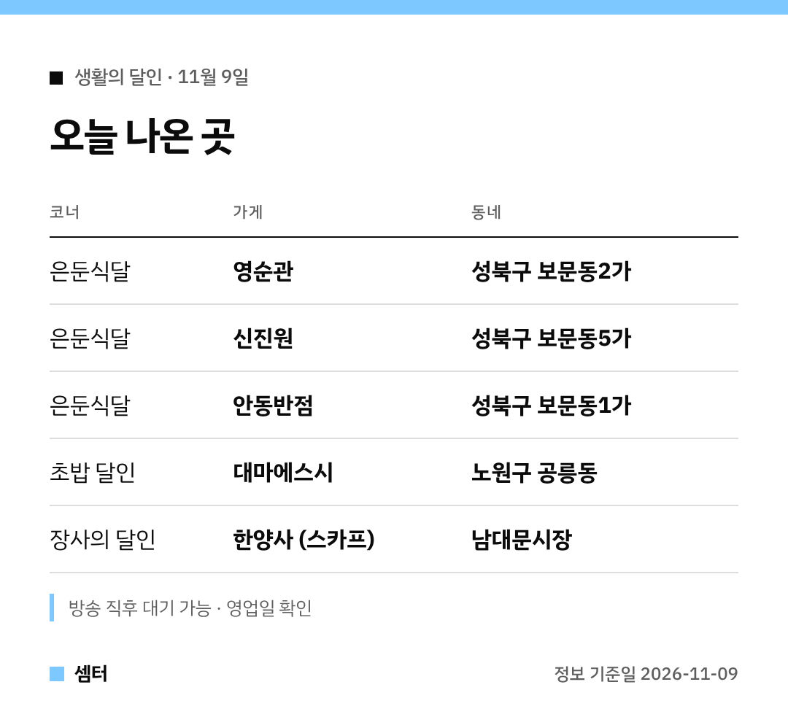

"생활의 달인에 나온 중국집 어디야?" 궁금하셨죠 🙂
오늘 나온 곳을 표로 먼저 정리했어요.

## 보문동 중국집 세 곳
성북구 보문동 골목엔 오래된 중식당이 모여 있어요.
방송은 그중 영순관, 신진원, 안동반점을 찾아갔어요.

겉모습보다 음식 맛으로 손님을 모은 노포들이에요.
짜장면·짬뽕·탕수육 중 집마다 자랑하는 메뉴가 달라요.

- [영순관 지도](https://map.naver.com/p/search/%EB%B3%B4%EB%AC%B8%EB%8F%99%20%EC%98%81%EC%88%9C%EA%B4%80) — 보문동2가
- [신진원 지도](https://map.naver.com/p/search/%EB%B3%B4%EB%AC%B8%EB%8F%99%20%EC%8B%A0%EC%A7%84%EC%9B%90) — 보문동5가
- [안동반점 지도](https://map.naver.com/p/search/%EB%B3%B4%EB%AC%B8%EB%8F%99%20%EC%95%88%EB%8F%99%EB%B0%98%EC%A0%90) — 보문동1가

## 반지하 초밥집
노원구 공릉동 대마에스시의 유영학 달인이 나왔어요.
고2 때부터 칼을 잡은 34년 경력이래요.

생선별로 숙성 시점을 맞춰 감칠맛을 살린대요.
곁들이는 초장도 직접 만든다고 해요 😊

[📍 대마에스시 지도](https://map.naver.com/p/search/%EA%B3%B5%EB%A6%89%EB%8F%99%20%EB%8C%80%EB%A7%88%EC%97%90%EC%8A%A4%EC%8B%9C)

## 남대문 스카프 아저씨
사지 말라고 말리는데 오히려 줄을 서는 가게예요.
남대문 한양사, 스카프 6개 1만 원이에요.

[📍 한양사 지도](https://map.naver.com/p/search/%EB%82%A8%EB%8C%80%EB%AC%B8%20%ED%95%9C%EC%96%91%EC%82%AC)

다들 맛있는 하루 보내시구! 오늘도 좋은 하루 보내세요~ㅎㅎ
