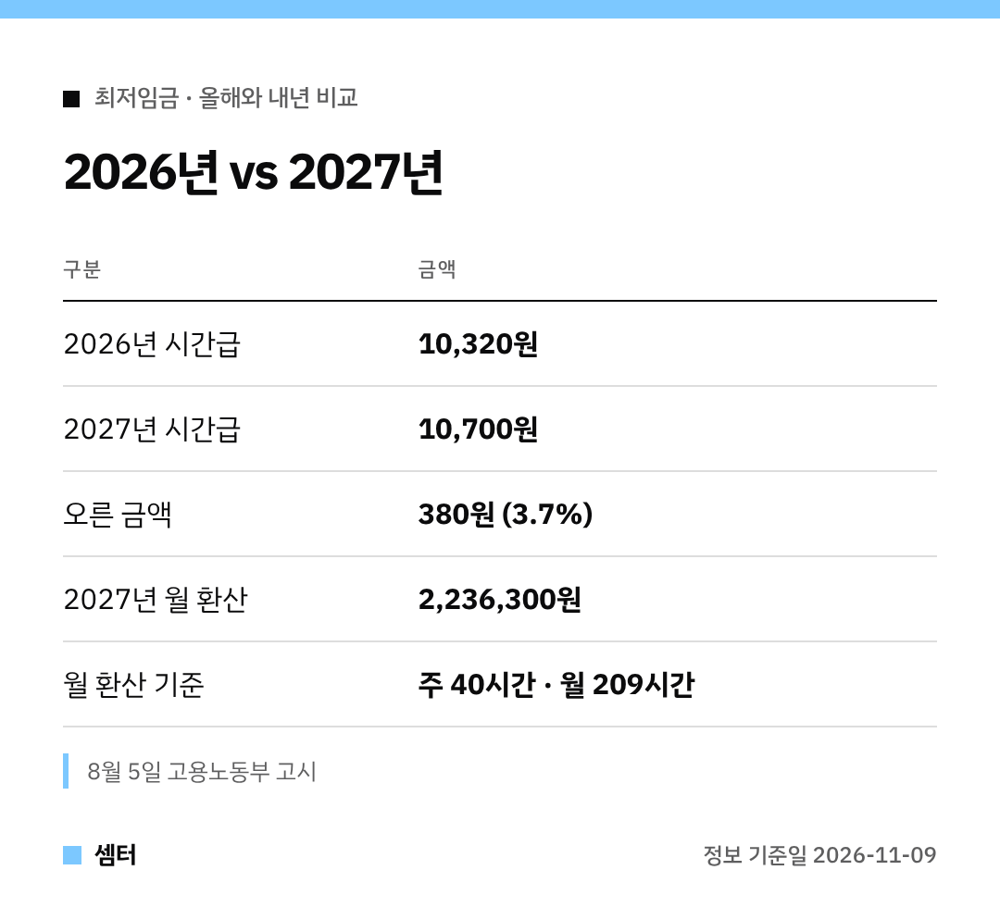

"내년 최저시급 얼마예요?" 요즘 이 질문 진짜 많이 받아요 🙂
숫자만 빠르게 보고 싶은 분들 위해 표로 먼저 보여 드릴게요.

## 확정된 금액
2027년도 적용 최저임금은 **시간급 10,700원**이에요.
고용노동부가 8월 5일 결정·고시해서 더 바뀌지 않아요.

올해 10,320원과 비교하면 380원, 3.7% 오른 거예요.

## 월 환산액 보는 법
주 40시간 일하면 한 달을 209시간으로 계산해요.
그래서 월 환산액은 2,236,300원이 나와요.

주 40시간이 아니라면 내 근무시간에 맞춰 따로 따져 봐야 해요!

## 차등 적용은 없어요
편의점, 식당, 사무실 모두 같아요.
사업 종류별 구분 없이 전 사업장에 동일하게 적용돼요.

도급제 근로자에게도 별도 최저임금을 두지 않았어요.

## 결정까지 걸린 길
- 7월 14일: 최저임금위원회 제14차 전원회의, 노사 최종안 10,730원 vs 10,700원 → 투표로 10,700원 의결
- 7월 16일: 고용노동부 최저임금안 고시
- 7월 27일까지: 이의제기 기간 (민주노총·소상공인연합회 이의, 수용 안 됨)
- 8월 5일: 최종 고시

## 함께 나온 얘기
최저임금위원회는 정부에 제도개선 추진단을 만들어 적용대상·결정기준을 전반적으로 검토해 달라고 권고했어요.
다음 심의 때 쓰일 수 있게 준비해 달라는 거예요 😊

다들 내 시급 꼼꼼히 챙기시구! 오늘도 좋은 하루 보내세요~ㅎㅎ
