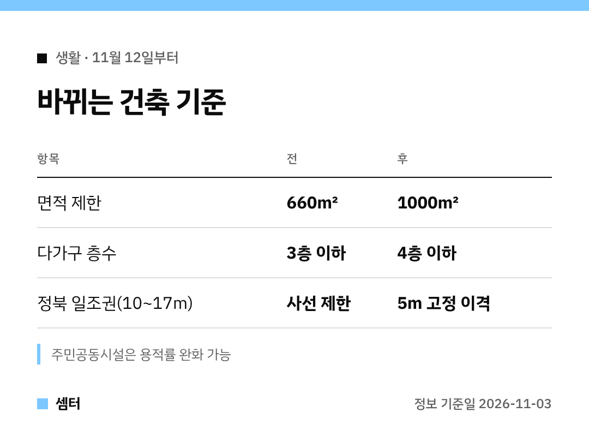

다가구 건물 가지고 계신 분들, "한 층 더 올릴 수 없나" 생각해 보신 적 있으시죠?ㅎㅎ
**11월 12일**부터 그게 가능해질 수 있어요 🙂

## 1. 다가구는 4층까지
다가구주택은 지금까지 3층 이하만 지을 수 있었어요.
이제 **4층 이하**로 한 층 더 올릴 수 있게 돼요.

## 2. 면적 제한 1000㎡로
다세대·다가구 모두 면적 제한이 660㎡에서 **1000㎡**로 넓어져요.
1990년대 이후 30년 넘게 그대로였던 기준이래요.

땅은 넓은데 면적 제한 때문에 용적률을 다 못 쓰던 곳이라면 눈여겨볼 만해요!

## 3. 일조권 사선 대신 5m 이격
높이 10m가 넘으면 위층을 비스듬히 깎아야 했던 정북 일조권 기준이 바뀌어요.
10m 초과~17m 이하 구간은 **5m 고정 이격**만 지키면 돼요.

덕분에 위층 공간을 더 반듯하게 쓸 수 있대요.

## 하나 더: 주민공동시설
다세대주택에 주민공동시설을 넣으면, 건축위원회를 거쳐 용적률을 완화받을 수 있어요.

## 어떻게 시작해요?
11월 3일 국무회의를 통과했고 12일부터 시행돼요.
내 땅에 실제로 적용되는지는 건축사·지자체와 꼭 상담하시고, 제도 문의는 국토교통부 건축정책과(044-201-4082)예요.

다들 좋은 계획 세우시구! 오늘도 좋은 하루 보내세요~ㅎㅎ
