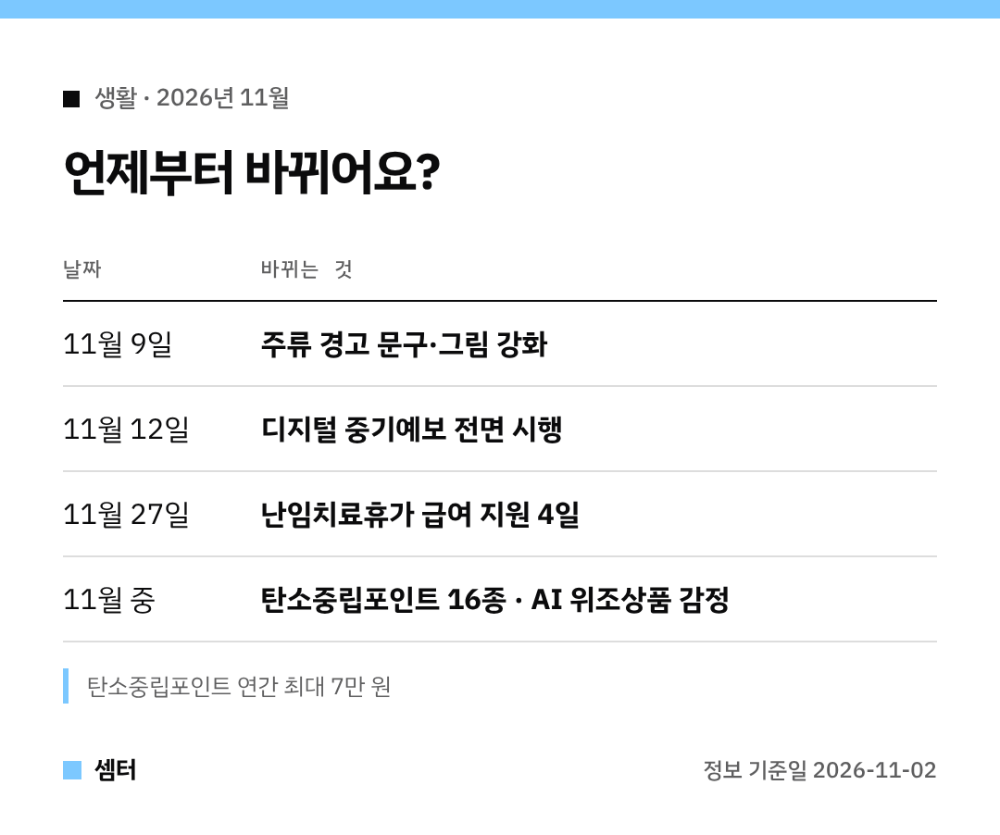

이번 달 바뀌는 정책, 나한테 해당되는 것만 빠르게 보고 싶으시죠~?
그래서 **누구에게 해당되는지**로 나눠 봤어요 🙂

## 아이를 준비하는 직장인이라면
난임치료휴가 6일 중 **유급이 4일**이 돼요(전엔 2일).
우선지원대상기업에 다니신다면 정부 급여 지원도 **11월 27일부터** 4일로 늘어나요.

받는 돈은 통상임금 기준이고 상한은 33만 6840원이에요.
휴가 끝난 날로부터 **12개월 안에** 청구해야 하니 잊지 마세요!

## 택시 자주 타는 분이라면
앱에서 **전기·수소 택시**를 골라 타면 탄소중립포인트가 쌓여요.
다회용 택배상자를 써도 적립돼요.

이렇게 항목이 16종으로 늘었고, 1년에 최대 7만 원까지예요.
텀블러·전자영수증처럼 원래 있던 항목이랑 같이 챙기면 좋겠죠?

## 회식 많은 분이라면
**11월 9일부터** 술병과 주류 광고 경고가 강해져요.
음주운전 위험 문구와 그림이 추가되고, 글자도 커진대요.

## 주말 계획 미리 세우는 분이라면
**11월 12일부터** 중기예보가 확 바뀌어요.
6~8일 뒤 날씨도 **3시간 단위**, 5km 격자 단위로 더 자세하게 볼 수 있어요.

"비 온다/안 온다" 대신 확률로 알려 주니까 여행 날짜 잡을 때 유용하겠어요!
날씨알리미 앱 '특보-예보' → '중기예보' 메뉴예요.

## 온라인 쇼핑 자주 하는 분이라면
산 물건이 가짜 같으면, 사진을 올려 감정을 신청할 수 있게 돼요.
AI 감정 보고서를 거쳐 환불이나 유통차단까지 이어지는 방식이래요.

## 지진 소식이 걱정되는 분이라면
일본 난카이 해곡 지진도 국외지진 조기경보 대상에 들어가요.
날씨누리나 날씨알리미 앱 '지진·화산' 메뉴에서 볼 수 있어요.

다들 해당되는 것 꼭 챙기시구! 오늘도 좋은 하루 보내세요~ㅎㅎ
