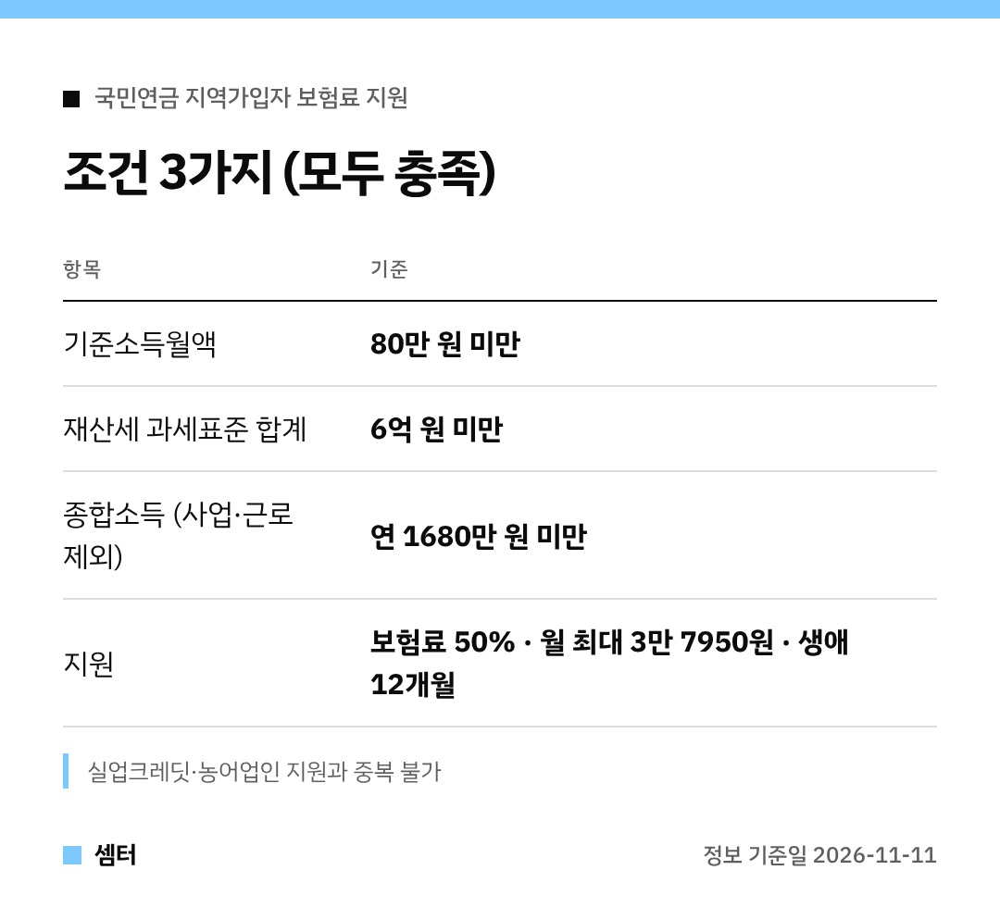

"나도 국민연금 보험료 지원 받을 수 있나?" 궁금하신 분들 🙂
조건부터 표로 보여 드릴게요.

## 지원 금액
월 연금보험료의 절반을 지원해요.
한 달에 최대 3만 7950원, 평생 통틀어 12개월까지예요.

## 체크 포인트
세 가지 조건을 다 맞춰야 해요.
하나라도 넘으면 대상이 아니니 꼼꼼히 보세요.

실업크레딧이나 농어업인 보험료 지원을 이미 받는 분은 같이 받을 수 없어요.

## 계속 내던 분도 OK
예전엔 보험료를 다시 내기 시작해야 받을 수 있었는데, 올해부터 그 요건이 사라졌어요.
쉬지 않고 납부해 온 분도 소득 기준만 맞으면 돼요.

## 신청 창구
- 국민연금공단 지사 방문·전화
- 모바일 앱 '내 곁에 국민연금' (6월부터)
- 국민연금공단 누리집

앱으로 하면 지사에 안 가도 되니 편해요 😊

다들 든든하게 노후 준비하시구! 오늘도 좋은 하루 보내세요~ㅎㅎ
