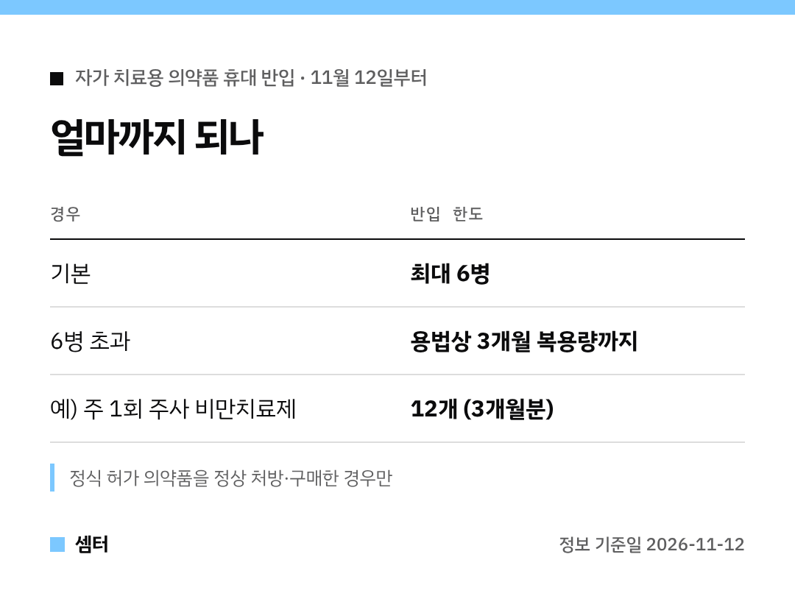

"현지에서 산 약 들고 와도 되나?" 여행 준비하면서 궁금하셨죠 🙂
새 기준을 표로 먼저 보여 드릴게요.

## 핵심 두 줄
6병까지는 그냥 들고 와도 돼요.
6병을 넘기면 복용법 기준으로 3개월치까지 가능해요.

## 조건이 있어요
그 나라 의약품 규제기관이 정식 허가한 약이어야 해요.
그걸 정상적으로 처방받거나 산 경우만 해당돼요.

## 이런 분들 해당돼요
- 국내 약을 챙겨 나갔다 들어오는 여행객
- 해외에서 처방받은 약을 가져오는 여행객
- 국내에 들어오는 외국인·유학생

## 왜 바뀌었나
정상 처방약인데도 세관에서 통관이 막히는 일이 자주 있었대요.
그래서 식약처가 관세청과 협의해 개인 휴대 반입을 허용했어요.

다들 편하게 여행하시구! 오늘도 좋은 하루 보내세요~ㅎㅎ
