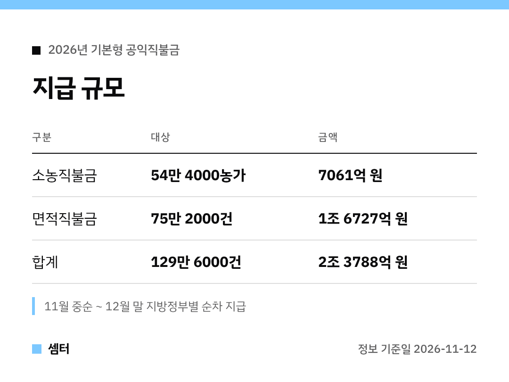

"직불금 언제 들어와요?" 해마다 이맘때 많이 물어보시죠 🙂
올해 지급 규모부터 표로 보여 드릴게요.

## 지급 시기
11월 중순부터 12월 말까지예요.
지방정부가 계좌를 확인한 뒤 차례로 입금하니 날짜는 지역마다 달라요.

## 소득 기준이 바뀌었어요
농업 외 종합소득금액 기준이 4700만 원으로 올라갔어요.
예전엔 3700만 원이 넘으면 못 받았거든요.

이 기준은 이달 13일부터 시행되고, 올해 면적직불금 등록신청자부터 적용돼요.

## 작년과 비교
- 대상: 128만 5000건 → 129만 6000건
- 지급 총액: 2조 3843억 원 → 2조 3788억 원 (55억 원 감소)
- 지급면적: 104만 5000㏊ → 103만 2000㏊

농지 전용과 자격 검증 때문에 면적은 조금 줄었대요.

## 감액 주의
16개 준수사항을 어기면 깎일 수 있어요.
올해는 1만 7255건이 감액됐대요 😊

다들 따뜻한 겨울 보내시구! 오늘도 좋은 하루 보내세요~ㅎㅎ
