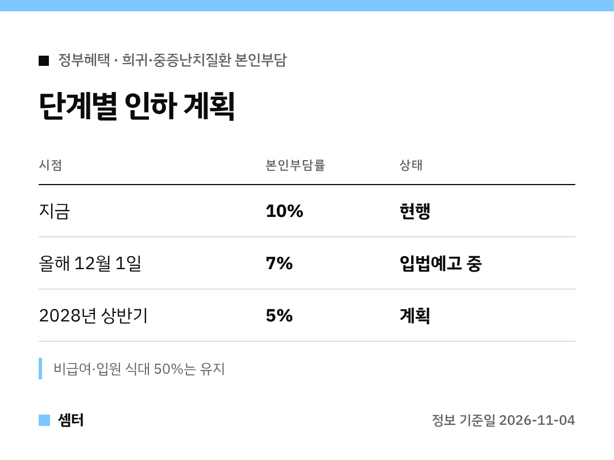

산정특례 받고 계신 분들, 병원비 영수증 볼 때마다 한숨 나오셨죠?
본인부담이 내려갈 예정이라 Q&A로 정리해 봤어요 🙂

## Q. 언제부터 얼마나 내려요?
**12월 1일부터** 급여 진료비 본인부담률이 **10% → 7%**로 낮아질 예정이에요.

## Q. 몇 명이나 해당돼요?
희귀·중증난치질환자 약 136만 명이래요.
1인당 연평균 부담이 약 75만 원에서 **53만 원** 정도로 줄 것으로 보고 있어요.

## Q. 왜 바뀌어요?
암·심뇌혈관 같은 다른 중증질환은 5%인데, 희귀·중증난치질환만 10%였어요.
이걸 같은 수준으로 맞추는 첫걸음이래요.

## Q. 더 내려가나요?
네, **2028년 상반기 5%**까지 내릴 계획이에요.
지난 9월 건강보험정책심의위원회에서 단계적으로 내리기로 했대요.

## Q. 비급여도 줄어요?
아니요, 비급여 진료비와 입원 식대(본인부담 50%)는 그대로예요.

## Q. 확정된 거예요?
아직은 **입법예고 단계(11월 16일까지)**예요.
법제처 심사와 국무회의 의결을 거쳐 12월 1일 시행이 목표래요.

문의는 보건복지부 보험정책과(044-202-2702)예요~

다들 힘내시구! 오늘도 좋은 하루 보내세요~ㅎㅎ
