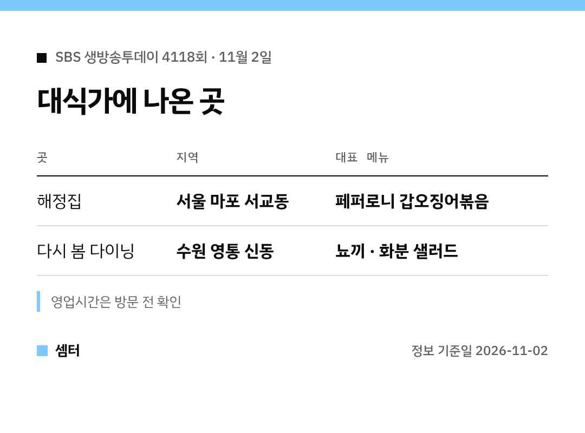

"페퍼로니가 갑오징어볶음에?" 오늘 생방송투데이 보다가 이 조합에 놀라신 분 계시죠ㅎㅎ
어디인지 바로 알려 드릴게요 🙂

## 페퍼로니 갑오징어볶음 집은?
이름은 '해정집'이에요.
서울 마포구 서교동, 합정역~상수역 사이에 있대요.

매콤한 퓨전 볶음이라 술안주로도, 밥반찬으로도 좋아 보여요.
곱창볶음이나 뼈해장국 같은 메뉴도 같이 팔아요.

[📍 네이버 지도에서 해정집 보기](https://map.naver.com/p/search/%EB%A7%88%ED%8F%AC%20%ED%95%B4%EC%A0%95%EC%A7%91)

## 화분 샐러드 집은?
'다시 봄 다이닝'이에요.
수원 영통구 신동, 신동카페거리 근처에 있는 양식 레스토랑이래요.

화분 모양 샐러드에, 매운맛을 더한 뇨끼가 소개됐어요.
파스타랑 화덕 피자 종류도 있어요!

[📍 네이버 지도에서 다시 봄 다이닝 보기](https://map.naver.com/p/search/%EC%88%98%EC%9B%90%20%EB%8B%A4%EC%8B%9C%EB%B4%84%EB%8B%A4%EC%9D%B4%EB%8B%9D)

## 두 집 비교
| | 해정집 | 다시 봄 다이닝 |
|---|---|---|
| 지역 | 서울 마포 서교동 | 수원 영통 신동 |
| 분위기 | 볶음·국밥 한식 | 양식 레스토랑 |
| 대표 메뉴 | 페퍼로니 갑오징어볶음 | 뇨끼 · 화분 샐러드 |

방송 직후엔 붐빌 수 있어서, 영업시간은 가기 전에 한 번 더 확인하세요~

다들 맛있는 하루 마무리하시구! 오늘도 좋은 하루 보내세요~ㅎㅎ
