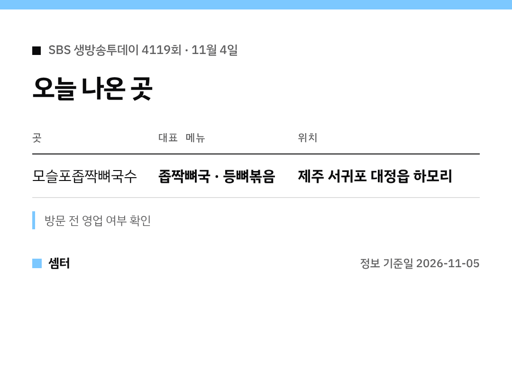

"좁짝뼈국"이라는 이름, 처음 들어 보신 분 많으시죠?ㅎㅎ
제주 토박이들이 즐겨 먹는 국이래요 🙂

## 가게 이름은?
'모슬포좁짝뼈국수'예요.
서귀포 대정읍 하모리, 모슬포항 주변에 있어요.

[📍 네이버 지도에서 모슬포좁짝뼈국수 보기](https://map.naver.com/p/search/%EB%AA%A8%EC%8A%AC%ED%8F%AC%EC%A2%81%EC%A7%9D%EB%BC%88%EA%B5%AD%EC%88%98)

## 좁짝뼈국은 어떤 맛?
좁짝뼈(접짝뼈)는 돼지 앞다리와 갈비 사이 부위예요.
뼈를 푹 우린 국물에 메밀가루를 넣어서 고소한 풍미가 난대요.

## 같이 시킬 만한 메뉴
등뼈볶음, 돼지산적, 돔베떡반이 있어요.
제주 서쪽 여행 동선에 넣어 보셔도 좋겠어요!

인기 집이라 대기가 있을 수 있으니, 가기 전에 영업 여부를 확인하세요~

다들 맛있는 여행 하시구! 오늘도 좋은 하루 보내세요~ㅎㅎ
