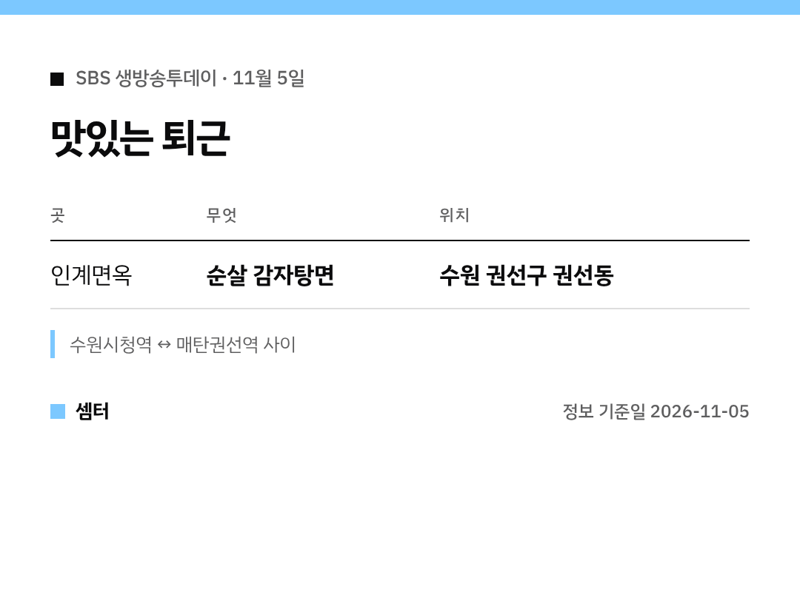

"생방송투데이에 나온 뼈 없는 감자탕면, 어디예요?" 하신 분들 바로 알려 드릴게요 🙂

## 가게 이름
수원 '인계면옥'이에요.
권선구 권선동, 수원시청역과 매탄권선역 중간쯤이래요.

[📍 인계면옥 지도](https://map.naver.com/p/search/%EC%88%98%EC%9B%90%20%EC%9D%B8%EA%B3%84%EB%A9%B4%EC%98%A5)

## 어떤 메뉴?
감자탕을 순살로 바꾸고 면을 넣었어요.
뼈 바를 필요 없이 국물이랑 고기, 면을 같이 즐기는 거죠~

퇴근하고 배고플 때 한 그릇이면 든든하겠어요!

## 팁
방송 직후엔 손님이 몰릴 수 있어요.
휴무일은 가기 전에 꼭 확인하세요.

다들 든든한 저녁 드시구! 오늘도 좋은 하루 보내세요~ㅎㅎ
