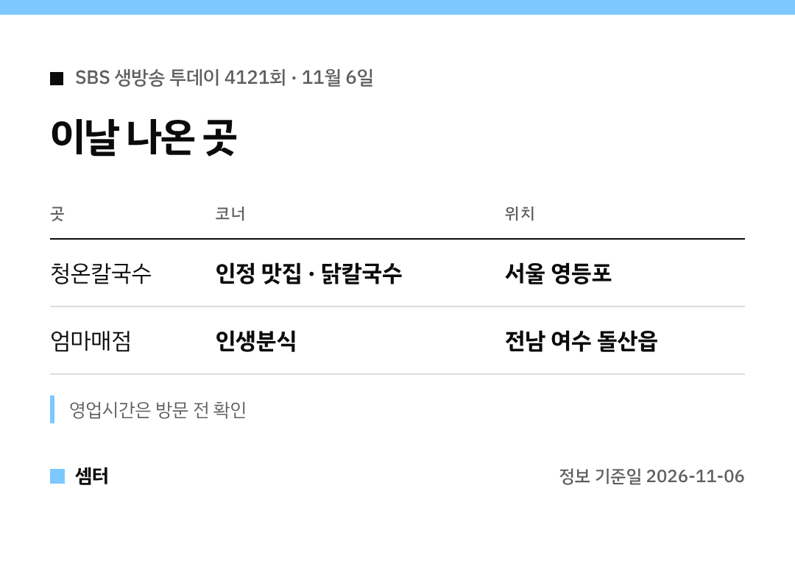

"생방송투데이 닭칼국수 거기 어디예요?" 바로 알려 드릴게요 🙂

## 닭칼국수 집
영등포에 있는 '청온칼국수'예요.
직접 반죽한 면을 따끈한 국물에 끓여 낸 한 그릇이래요.

[📍 청온칼국수 지도](https://map.naver.com/p/search/%EC%98%81%EB%93%B1%ED%8F%AC%20%EC%B2%AD%EC%98%A8%EC%B9%BC%EA%B5%AD%EC%88%98)

## 같이 나온 곳
인생분식 코너에서는 여수 돌산읍의 '엄마매점'이 나왔어요.
오랜 세월 정을 나눠 온 매점 이야기가 소개됐어요.

[📍 엄마매점 지도](https://map.naver.com/p/search/%EC%97%AC%EC%88%98%20%EB%8F%8C%EC%82%B0%20%EC%97%84%EB%A7%88%EB%A7%A4%EC%A0%90)

## 팁
방송 직후엔 대기가 생길 수 있어요.
출발 전에 영업 여부 꼭 확인하세요!

다들 든든한 저녁 챙기시구! 오늘도 좋은 하루 보내세요~ㅎㅎ
