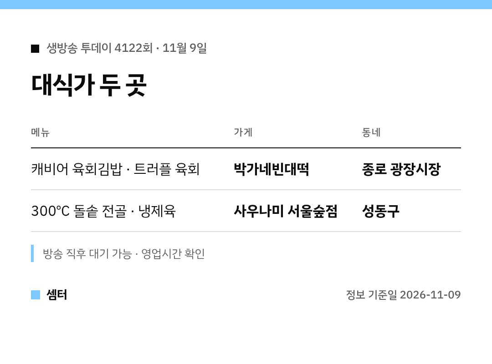

오늘 생방송 투데이 보다가 "저기 어디야?" 하신 분들 계시죠? 🙂
대식가 코너 두 곳, 표로 먼저 보여 드릴게요.

## 캐비어 육회김밥은 광장시장
외국인 손님이 많은 종로 광장시장 편이었어요.
육회김밥에 캐비어를 얹은 메뉴, 트러플 향을 더한 육회가 나왔어요.

가게는 **박가네빈대떡**이에요.
빈대떡에 육전, 모둠전까지 시장 메뉴가 두루 있어요.

[📍 지도에서 보기](https://map.naver.com/p/search/%EA%B4%91%EC%9E%A5%EC%8B%9C%EC%9E%A5%20%EB%B0%95%EA%B0%80%EB%84%A4%EB%B9%88%EB%8C%80%EB%96%A1)

## 돌솥 전골은 서울숲
성동구 편은 뜨거운 돌솥 전골이 주인공이었어요.
약 300℃ 돌솥에서 끓는 채로 상에 올라온대요.

곁들이는 냉제육은 24시간 숙성한 거래요.
가게는 **사우나미 서울숲점**이에요 😊

[📍 지도에서 보기](https://map.naver.com/p/search/%EC%82%AC%EC%9A%B0%EB%82%98%EB%AF%B8%20%EC%84%9C%EC%9A%B8%EC%88%B2%EC%A0%90)

## 꿀팁
광장시장은 안이 넓어서 길 잃기 쉬워요.
지도 링크로 위치를 먼저 확인하고 가세요!

다들 맛있게 드시구! 오늘도 좋은 하루 보내세요~ㅎㅎ
