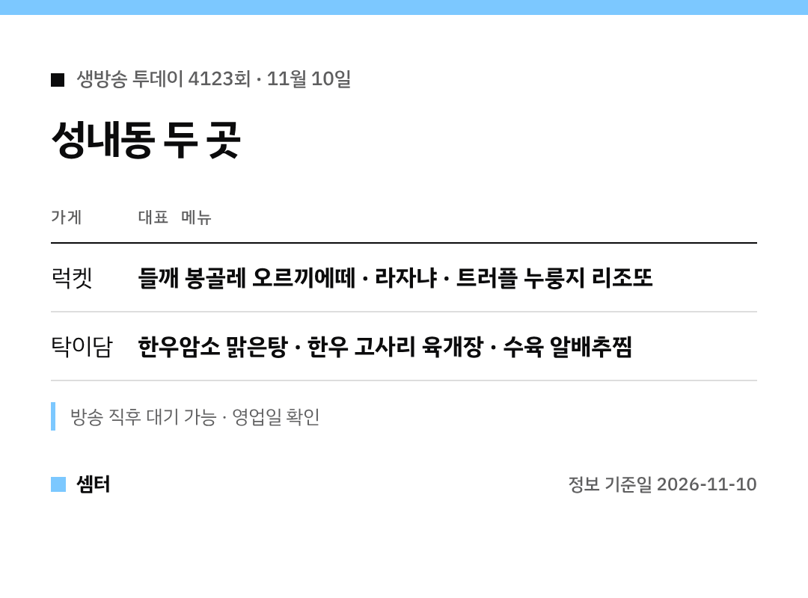

"오늘 생방송 투데이 성내동 거기 어디야?" 하신 분들 🙂
두 곳을 표로 먼저 보여 드릴게요.

## 럭켓
강동구청역에서 가까운 레스토랑이에요.
들깨를 넣은 봉골레 오르끼에떼가 이 집 대표 메뉴래요.

메뉴는 셰프가 직접 준비하고 한정 수량으로 낸대요.
분위기가 차분해서 소개팅이나 작은 모임에도 좋아요.

[📍 럭켓 지도](https://map.naver.com/p/search/%EC%84%B1%EB%82%B4%EB%8F%99%20%EB%9F%AD%EC%BC%93)

## 탁이담
성내전통시장 쪽 한우 한식집이에요.
맑게 끓인 한우암소 탕과 고사리 육개장이 나왔어요.

수육 알배추찜도 함께 소개됐어요 😊

[📍 탁이담 지도](https://map.naver.com/p/search/%EC%84%B1%EB%82%B4%EB%8F%99%20%ED%83%81%EC%9D%B4%EB%8B%B4)

다들 맛있게 드시구! 오늘도 좋은 하루 보내세요~ㅎㅎ
