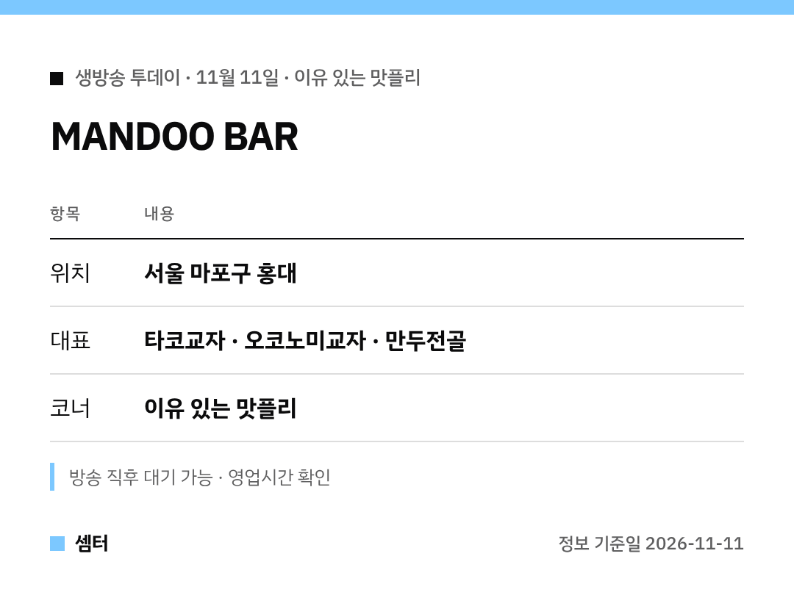

만두에 타코? 교자에 오코노미야키 토핑? 궁금하셨죠 🙂
표로 먼저 정리했어요.

## 어떤 집이에요?
홍대에 있는 만두 전문점이에요.
전통 만두 맛에 요즘 입맛을 섞은 퓨전 교자가 주력이래요.

## 메뉴 고르기
처음이면 기본 교자부터, 여럿이면 만두전골이 좋아요.
전골엔 만두와 버섯, 유부, 게살완탕, 채소가 들어가요.

특이한 걸 원하면 타코교자나 유린기교자를 골라 보세요 😊

## 방문 전 체크
방송 직후엔 대기가 생길 수 있어요.
영업시간과 휴무일은 지도에서 확인하고 가세요.

[📍 지도에서 보기](https://map.naver.com/p/search/%ED%99%8D%EB%8C%80%20%EB%A7%8C%EB%91%90%EB%B0%94)

다들 맛있는 하루 보내시구! 오늘도 좋은 하루 보내세요~ㅎㅎ
