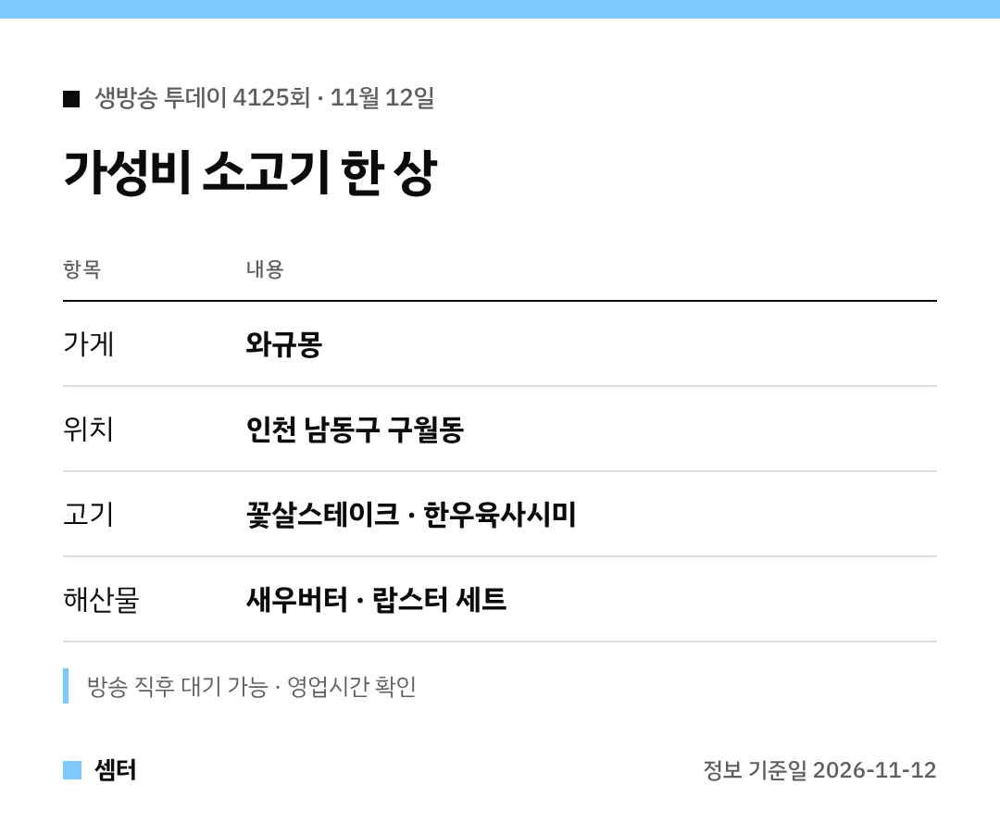

"생방송 투데이 소고기 한 상 거기 어디야?" 궁금하셨죠 🙂
표로 먼저 정리했어요.

## 어떤 집이에요?
인천 구월동에 있는 소고기 전문점 와규몽이에요.
와규와 한우, 랍스터를 한자리에서 먹을 수 있게 차렸대요.

## 메뉴 고르기
고기파라면 꽃살스테이크와 한우육사시미를 많이 찾는대요.
해산물까지 원하면 새우버터나 랍스터 세트가 있어요.

## 지도
[📍 와규몽 지도](https://map.naver.com/p/search/%EA%B5%AC%EC%9B%94%EB%8F%99%20%EC%99%80%EA%B7%9C%EB%AA%BD)

특별한 날 식사나 회식 장소로도 괜찮대요 😊

다들 맛있는 저녁 드시구! 오늘도 좋은 하루 보내세요~ㅎㅎ
