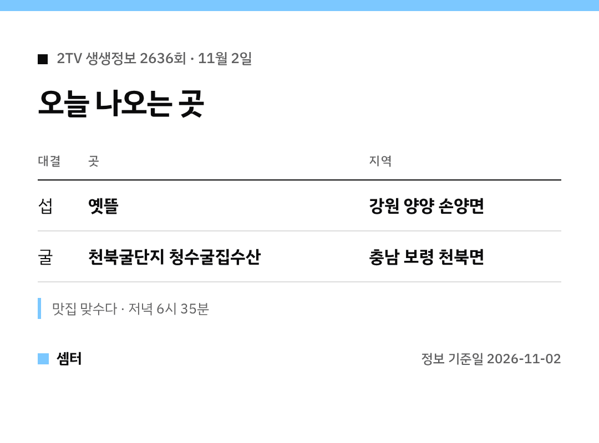

섭파세요, 굴파세요~?
오늘 생생정보는 딱 이 질문으로 대결을 벌인대요ㅎㅎ 두 집 위치랑 메뉴부터 콕 집어 볼게요 😊

## 섭 요리 집은 어디예요?
이름은 '옛뜰'이에요.
강원 양양 손양면 송전리에 있대요.

섭국, 섭밥, 섭비빔밥이 간판 메뉴고요.
오향섭밥, 순두부째복탕, 송이두부구이양념찜 같은 메뉴도 판대요.

[📍 네이버 지도에서 옛뜰 보기](https://map.naver.com/p/search/%EC%96%91%EC%96%91%20%EC%98%9B%EB%9C%B0)

## 굴 요리 집은 어디예요?
'천북굴단지 청수굴집수산'이에요.
충남 보령 천북면 장은리, 굴단지 안에 있어요.

굴찜이 대표고, 굴전이랑 굴무침도 인기래요!

[📍 네이버 지도에서 청수굴집수산 보기](https://map.naver.com/p/search/%EC%B2%9C%EB%B6%81%EA%B5%B4%EB%8B%A8%EC%A7%80%20%EC%B2%AD%EC%88%98%EA%B5%B4%EC%A7%91%EC%88%98%EC%82%B0)

## 섭이 뭐였더라?
동해안에서 나는 토종 홍합이에요.
보통 홍합보다 크고 살이 두툼해서 국으로 끓이면 시원하대요.

## 두 집 비교
| | 옛뜰 | 청수굴집수산 |
|---|---|---|
| 바다 별미 | 섭 | 굴 |
| 지역 | 강원 양양 | 충남 보령 |
| 대표 메뉴 | 섭국·섭밥·섭비빔밥 | 굴찜·굴전·굴무침 |

인기 집이라 방송 뒤엔 대기가 길 수 있어요.
출발 전에 영업시간 한 번 확인하고 가세요!

오늘 방송엔 익산 여행, 충주 수안보 꽃나물 빵집 이야기도 함께 나온대요.

다들 맛있는 저녁 드시구! 오늘도 좋은 하루 보내세요~ㅎㅎ
