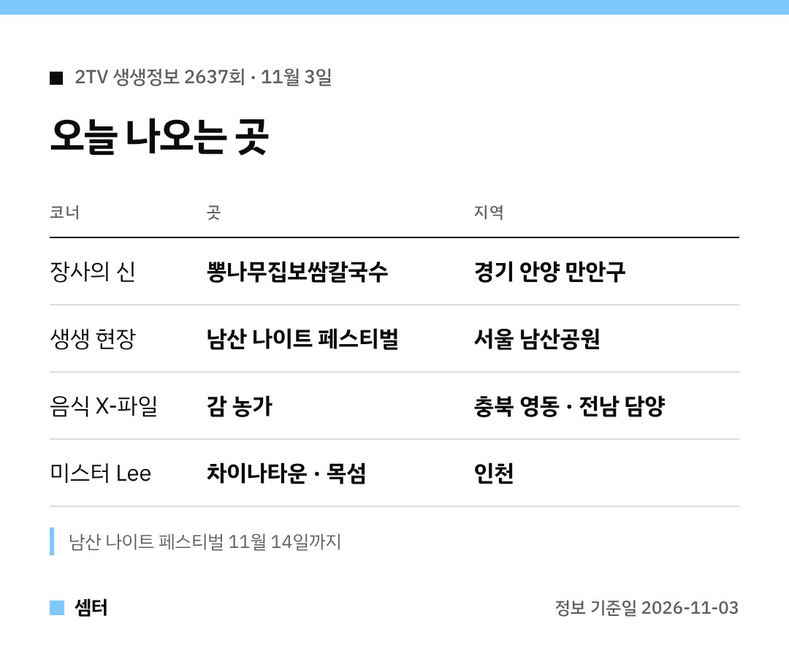

보쌈 좋아하시는 분 손~!
오늘 생생정보 보쌈집이 어디냐는 분들 많을 것 같아 위치부터 콕 짚어 볼게요 😊

## 보쌈·청국장 집은 어디예요?
이름은 '뽕나무집보쌈칼국수'예요.
경기 안양 만안구 석수동, 관악역에서 걸어갈 수 있는 거리래요.

보쌈 세 가지에 청국장을 곁들이는 정식이 오늘의 메뉴고요.
이름처럼 꾸지뽕을 넣은 요리를 내는 집이에요!

[📍 네이버 지도에서 뽕나무집보쌈칼국수 보기](https://map.naver.com/p/search/%EC%95%88%EC%96%91%20%EB%BD%95%EB%82%98%EB%AC%B4%EC%A7%91%EB%B3%B4%EC%8C%88%EC%B9%BC%EA%B5%AD%EC%88%98)

## 같은 날 나온 남산 축제는 언제까지?
'2026 남산 나이트 페스티벌'은 11월 14일까지 열려요.
백범광장 잔디밭에서 하는 '남산 캠프닉'이 대표 프로그램이에요.

[📍 네이버 지도에서 백범광장 보기](https://map.naver.com/p/search/%EB%82%A8%EC%82%B0%EA%B3%B5%EC%9B%90%20%EB%B0%B1%EB%B2%94%EA%B4%91%EC%9E%A5)

## 그 밖의 코너
| 코너 | 내용 |
|---|---|
| 음식 X-파일 | 영동·담양 감 이야기 |
| 미스터 Lee | 인천 차이나타운·목섬 |
| 힘쓰니까 청춘이다 | 아산 고물상 청년 |

인기 집은 방송 직후 대기가 길어요.
출발 전에 영업시간 한 번 확인하고 가세요~

다들 맛있는 저녁 드시구! 오늘도 좋은 하루 보내세요~ㅎㅎ
