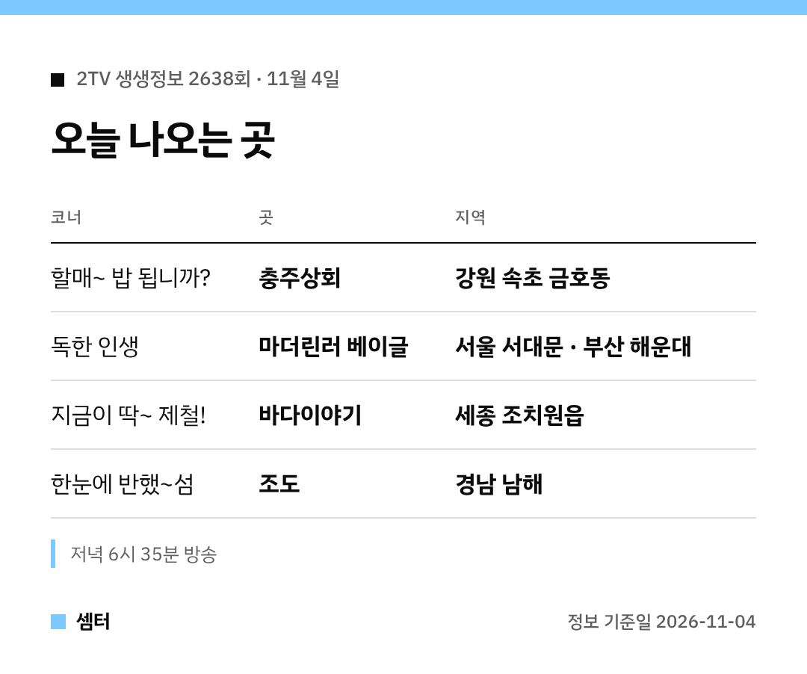

오징어순대 좋아하시는 분 손~!
오늘 생생정보에 나온 속초 순대집이 어디인지 바로 알려 드릴게요 😊

## 오징어꽃순대 집은 어디예요?
이름은 '충주상회'예요.
강원 속초 금호동, 속초중앙시장 근처에 있대요.

명순 할머니가 만드는 오징어꽃순대가 대표고요.
막창순대, 누룽지순대도 같이 판대요!

[📍 네이버 지도에서 충주상회 보기](https://map.naver.com/p/search/%EC%86%8D%EC%B4%88%20%EC%B6%A9%EC%A3%BC%EC%83%81%ED%9A%8C)

## 베이글 집은?
'마더린러 베이글'이에요.
서울 서대문구(이대 근처) 매장과 부산 해운대점이 같이 소개돼요.

[📍 네이버 지도에서 마더린러 베이글 보기](https://map.naver.com/p/search/%EB%A7%88%EB%8D%94%EB%A6%B0%EB%9F%AC%20%EB%B2%A0%EC%9D%B4%EA%B8%80)

## 홍가리비는?
세종 조치원읍 '바다이야기'에서 제철 홍가리비를 맛볼 수 있대요.

[📍 네이버 지도에서 바다이야기 보기](https://map.naver.com/p/search/%EC%A1%B0%EC%B9%98%EC%9B%90%20%EB%B0%94%EB%8B%A4%EC%9D%B4%EC%95%BC%EA%B8%B0)

## 섬 여행은?
경남 남해군 조도예요.
조도어촌체험휴양마을에서 어촌 체험과 숙박도 할 수 있어요.

[📍 네이버 지도에서 조도어촌체험휴양마을 보기](https://map.naver.com/p/search/%EB%82%A8%ED%95%B4%20%EC%A1%B0%EB%8F%84%EC%96%B4%EC%B4%8C%EC%B2%B4%ED%97%98%ED%9C%B4%EC%96%91%EB%A7%88%EC%9D%84)

인기 집은 방송 뒤에 대기가 길 수 있으니 미리 확인하고 가세요~

다들 맛있는 저녁 드시구! 오늘도 좋은 하루 보내세요~ㅎㅎ
