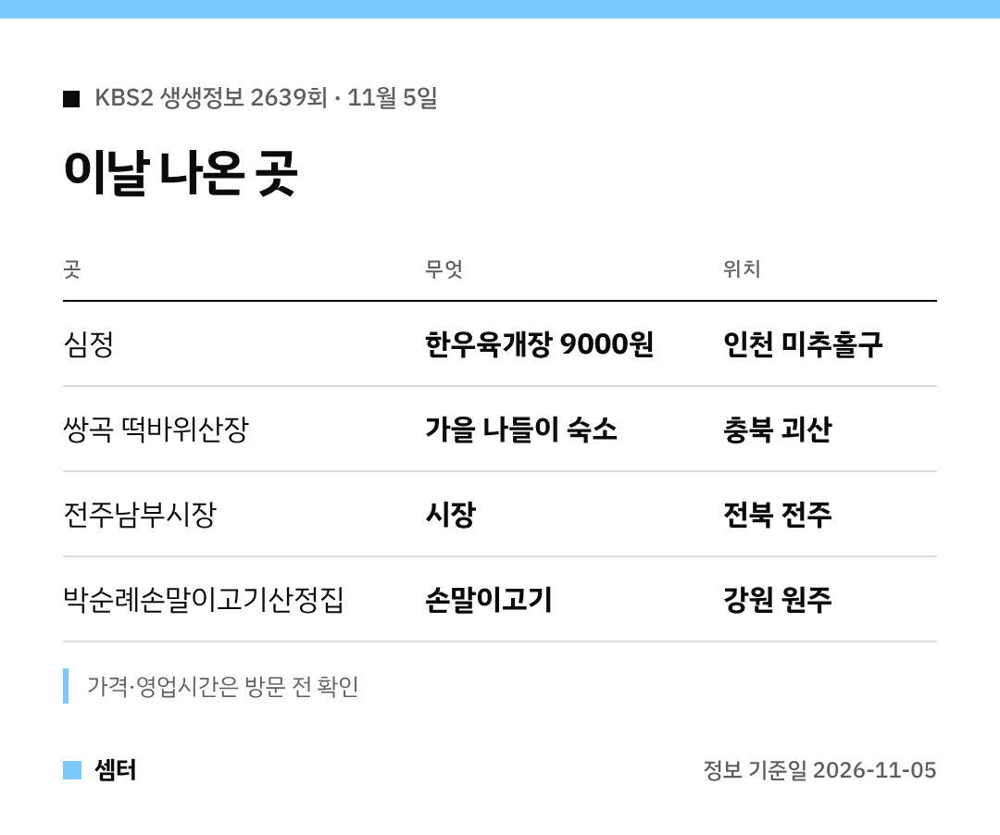

"한우육개장 9000원 거기 어디야?" 방송 보고 찾으신 분들 여기예요 🙂

## 육개장집 이름은?
인천 미추홀구에 있는 '심정'이에요.
'가격파괴 Why' 코너에서 한우육개장 가격의 비밀을 다뤘어요.

## 얼마예요?
육개장은 9000원이에요.
고물가에 이 가격이면 정말 반갑죠~

[📍 심정 지도](https://map.naver.com/p/search/%EC%9D%B8%EC%B2%9C%20%EB%AF%B8%EC%B6%94%ED%99%80%EA%B5%AC%20%EC%8B%AC%EC%A0%95)

## 숙소는 어디였어요?
'숙소를 찾아 줘' 코너는 괴산 쌍곡계곡 근처 '쌍곡 떡바위산장'이었어요.
엄마들끼리 떠나는 가을 보양 나들이 콘셉트였답니다.

[📍 쌍곡 떡바위산장 지도](https://map.naver.com/p/search/%EA%B4%B4%EC%82%B0%20%EC%8C%8D%EA%B3%A1%20%EB%96%A1%EB%B0%94%EC%9C%84%EC%82%B0%EC%9E%A5)

## 시장 코너
전주남부시장도 소개됐어요.
하루에 세 번 얼굴이 바뀌는 시장이라 언제 가도 볼거리가 있겠어요!

[전주남부시장 지도](https://map.naver.com/p/search/%EC%A0%84%EC%A3%BC%EB%82%A8%EB%B6%80%EC%8B%9C%EC%9E%A5)

## 원주 여행 코스도 나왔어요
'장PD의 AI 여행기'는 원주였어요.
반계리 은행나무 → 소금산 그랜드밸리 → 산악자전거파크 → 강원감영 순서로 돌았대요.

식당은 손말이고기로 유명한 '박순례손말이고기산정집'이었어요.

[📍 박순례손말이고기산정집 지도](https://map.naver.com/p/search/%EC%9B%90%EC%A3%BC%20%EB%B0%95%EC%88%9C%EB%A1%80%EC%86%90%EB%A7%90%EC%9D%B4%EA%B3%A0%EA%B8%B0%EC%82%B0%EC%A0%95%EC%A7%91)

다들 따끈한 국물로 몸 녹이시구! 오늘도 좋은 하루 보내세요~ㅎㅎ
