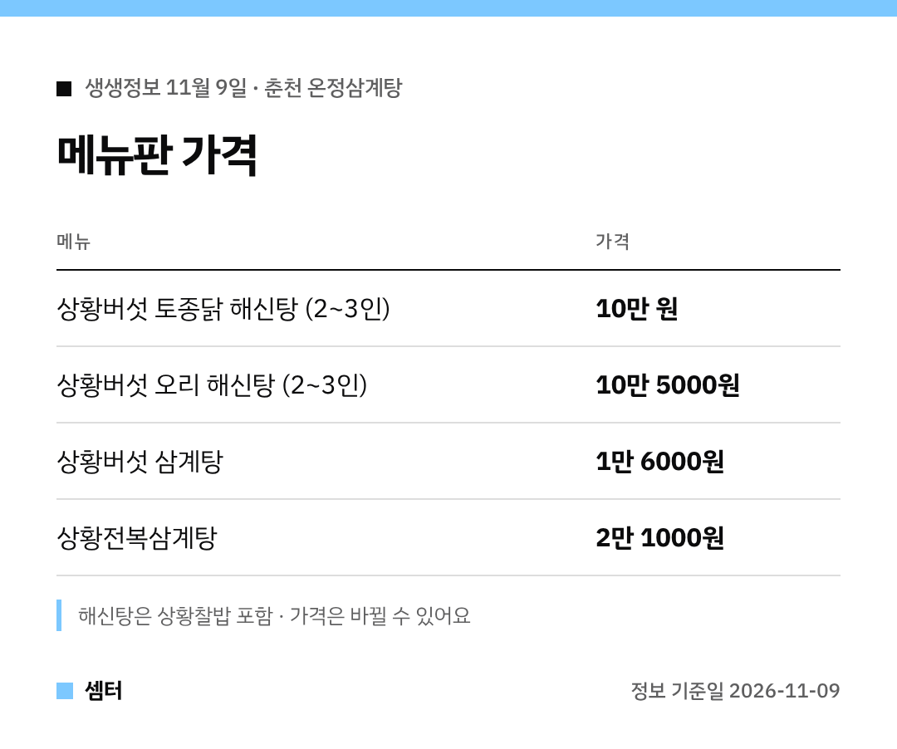

오늘 생생정보 보다가 해신탕 비주얼에 침 고이신 분들 손~ 🙋
어디인지, 얼마인지 바로 알려 드릴게요.

## 어디예요?
강원 춘천 퇴계동의 **온정삼계탕**이에요.
생생정보 2640회 '결정적 한 수' 코너에 나왔어요.

주소: 강원 춘천시 우묵길78번길 3

[📍 네이버 지도에서 보기](https://map.naver.com/p/search/%EC%B6%98%EC%B2%9C%20%EC%98%A8%EC%A0%95%EC%82%BC%EA%B3%84%ED%83%95)

## 무엇이 유명해요?
상황버섯을 넣은 보양식이 주력이에요.
해신탕은 토종닭과 오리 두 가지가 있어요.

닭고기에 해산물을 넣고 끓여서 국물 맛이 깊대요.
매콤한 상황버섯 닭볶음탕, 해산물을 더한 해신닭볶음탕도 있답니다.

## 몇 명이 가면 좋아요?
해신탕은 2~3인용이에요.
혼밥이라면 1인용 삼계탕 메뉴가 부담 없어요 😊

## 방문 팁
방송 직후엔 대기가 생길 수 있어요.
출발 전에 지도에서 영업시간을 확인해 보세요!

다들 따끈하게 한 그릇 하시구! 오늘도 좋은 하루 보내세요~ㅎㅎ
