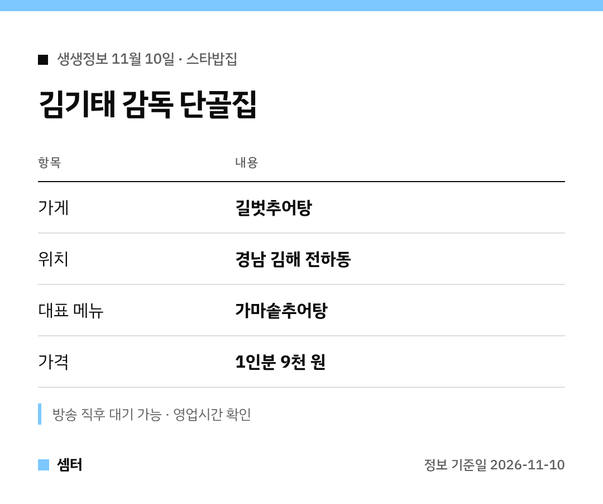

씨름 하면 떠오르는 김기태 감독, 단골집이 어딘지 궁금하셨죠? 🙂
표로 먼저 정리해 봤어요.

## 어떤 집이에요?
경남 김해 전하동에 있는 **길벗추어탕**이에요.
김기태 감독이 오랫동안 꾸준히 찾는 곳이래요.

## 뭘 먹어요?
가마솥에 끓인 추어탕이 대표예요.
미꾸라지를 쓴 전통 조리법이라 국물이 진하대요.

가격은 1인분 9천 원이에요 😊

## 지도
[📍 네이버 지도에서 보기](https://map.naver.com/p/search/%EA%B9%80%ED%95%B4%20%EA%B8%B8%EB%B2%97%EC%B6%94%EC%96%B4%ED%83%95%20%EB%B3%B8%EC%A0%90)

다들 든든한 한 끼 하시구! 오늘도 좋은 하루 보내세요~ㅎㅎ
