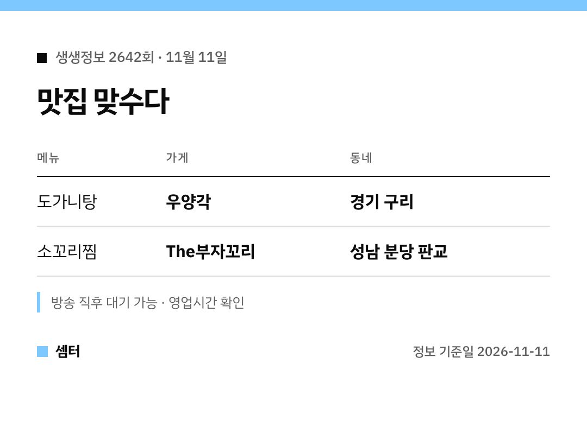

도가니탕 vs 소꼬리찜, 여러분은 어느 쪽이세요? 🙂
두 집을 표로 먼저 보여 드릴게요.

## 구리 우양각
도가니탕이 대표 메뉴예요.
도가니는 연골과 힘줄 부위라 설렁탕·곰탕과는 쓰는 부위가 달라요.

오래 끓여서 국물이 진하고 건더기가 쫀득하대요.

[📍 우양각 지도](https://map.naver.com/p/search/%EA%B5%AC%EB%A6%AC%20%EC%9A%B0%EC%96%91%EA%B0%81)

## 판교 The부자꼬리
소꼬리를 푹 익혀 양념에 조린 찜이 대표예요.
국물보다 부드러운 고기와 양념 맛을 즐기는 메뉴죠.

백현 카페거리 근처 맛집으로 추천한다는 방문 후기도 있었대요 😊

[📍 The부자꼬리 지도](https://map.naver.com/p/search/%ED%8C%90%EA%B5%90%20%EB%8D%94%EB%B6%80%EC%9E%90%EA%BC%AC%EB%A6%AC)

다들 맛있는 보양식 드시구! 오늘도 좋은 하루 보내세요~ㅎㅎ
