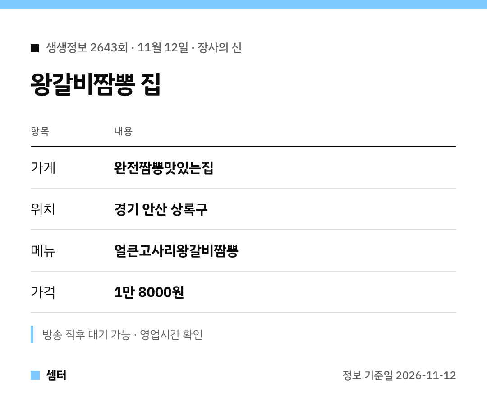

"생생정보 왕갈비짬뽕 어디야?" 궁금하셨죠 🙂
한눈에 보이게 표로 먼저 정리했어요.

## 어떤 메뉴예요?
짬뽕 국물에 큼직한 왕갈비와 고사리를 넣었어요.
한식 재료와 중식 조리법을 합친 메뉴래요.

갈비를 함께 끓여서 국물에 고기 맛이 스며든대요.

## 가격과 위치
한 그릇 1만 8000원이에요.
주소는 경기 안산시 상록구 상록수로 28이에요.

[📍 지도에서 보기](https://map.naver.com/p/search/%EC%95%88%EC%82%B0%20%EC%99%84%EC%A0%84%EC%A7%AC%EB%BD%95%EB%A7%9B%EC%9E%88%EB%8A%94%EC%A7%91)

## 방문 팁
면과 건더기를 같이 먹을 수 있어 한 그릇으로 충분하대요 😊
방송 직후엔 대기가 생길 수 있어요.

다들 맛있는 하루 보내시구! 오늘도 좋은 하루 보내세요~ㅎㅎ
