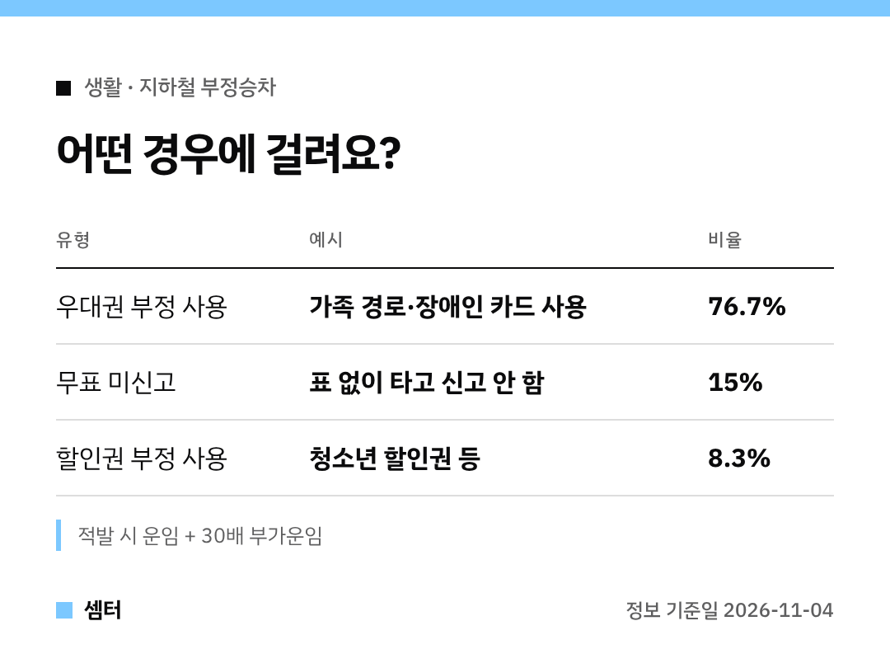

지하철 부정승차, "설마 걸리겠어?" 하는 순간이 제일 위험해요ㅎㅎ
올해 서울에서만 9월까지 **3만 건 넘게** 걸렸대요 🙂

## 부가운임 계산법
걸리면 **탄 구간 운임 + 그 운임의 30배**를 내야 해요.
철도사업법과 공사 여객운송약관에 정해진 거예요.

## 1위: 남의 우대권 쓰기 (76.7%)
노인·장애인 우대용 교통카드를 다른 사람이 쓰는 경우예요.
가족 카드라도 본인이 아니면 부정승차예요!

## 2위: 표 없이 타기 (15%)
표 없이 타고 내릴 때 신고도 안 한 경우래요.

## 3위: 할인권 잘못 쓰기 (8.3%)
청소년 할인권처럼 대상이 아닌데 할인 카드를 쓰는 경우예요.
아이가 커서 나이가 지났다면 카드 등록 정보도 같이 바꿔 주세요.

## 숫자로 보면
- 올해 1~9월 징수액: 약 16억 5천만 원
- 2023~2025년: 약 16만 건, 약 77억 원

지금 수도권 철도 운영기관들이 함께 예방 캠페인과 단속을 하고 있으니, 조심하세요~

다들 안전하게 다니시구! 오늘도 좋은 하루 보내세요~ㅎㅎ
