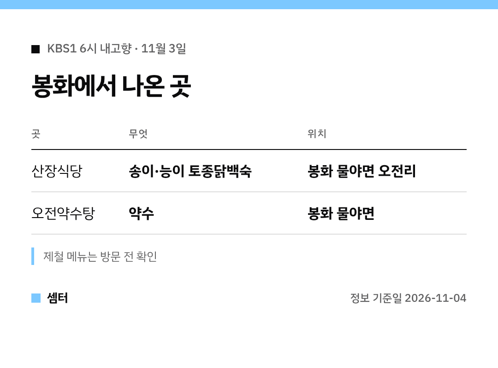

"6시 내고향에 나온 봉화 백숙집 어디예요?" 하실 분들 위해 바로 정리했어요 🙂

## 백숙집 이름은?
'산장식당'이에요.
경북 봉화군 물야면 오전리에 있대요.

## 뭐가 유명해요?
자연산 송이나 능이를 넣은 **토종닭백숙**이 대표 메뉴예요.
한방백숙, 옻닭백숙, 한방오리백숙도 있어요.

[📍 네이버 지도에서 산장식당 보기](https://map.naver.com/p/search/%EB%B4%89%ED%99%94%20%EB%AC%BC%EC%95%BC%EB%A9%B4%20%EC%82%B0%EC%9E%A5%EC%8B%9D%EB%8B%B9)

## 근처에 들를 곳
방송에선 백숙을 먹은 뒤 **오전약수탕**으로 이어 갔어요.
조선시대부터 약수로 손꼽혀 온 곳이라 함께 둘러보기 좋아요!

[📍 네이버 지도에서 오전약수탕 보기](https://map.naver.com/p/search/%EB%B4%89%ED%99%94%20%EC%98%A4%EC%A0%84%EC%95%BD%EC%88%98%ED%83%95)

멀리서 가시는 길이라면 영업 여부와 메뉴를 미리 전화로 확인하고 출발하세요~

다들 따뜻하게 보내시구! 오늘도 좋은 하루 보내세요~ㅎㅎ
