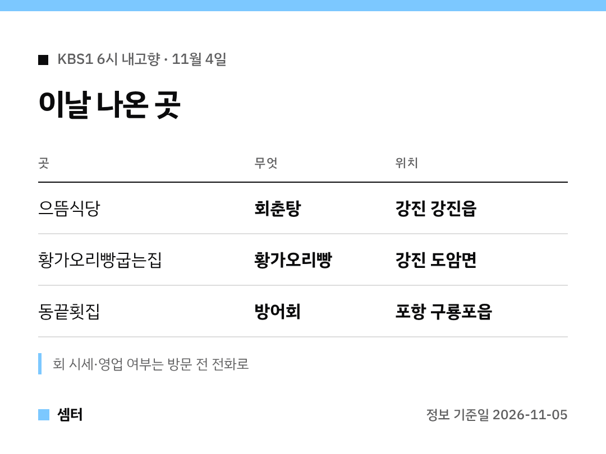

"어제 6시 내고향 회춘탕 거기 어디예요?" 궁금하셨던 분들 위해 정리해 왔어요 🙂

## 회춘탕 식당 이름은?
'으뜸식당'이에요.
전남 강진군 강진읍에 있답니다.

방송에서는 기운 나는 보양식으로 회춘탕을 크게 다뤘어요.
출발 전에 전화로 확인하고 가시는 걸 추천해요!

[📍 으뜸식당 지도](https://map.naver.com/p/search/%EA%B0%95%EC%A7%84%20%EC%9C%BC%EB%9C%B8%EC%8B%9D%EB%8B%B9)

## 강진에서 같이 들를 곳
방송은 강진만생태공원 갈대길, 강진오감통시장도 소개했어요.
군것질은 도암면 황가오리빵굽는집에서 하면 되겠죠~

[강진만생태공원 지도](https://map.naver.com/p/search/%EA%B0%95%EC%A7%84%EB%A7%8C%EC%83%9D%ED%83%9C%EA%B3%B5%EC%9B%90)
[강진오감통시장 지도](https://map.naver.com/p/search/%EA%B0%95%EC%A7%84%EC%98%A4%EA%B0%90%ED%86%B5%EC%8B%9C%EC%9E%A5)
[황가오리빵굽는집 지도](https://map.naver.com/p/search/%EA%B0%95%EC%A7%84%20%ED%99%A9%EA%B0%80%EC%98%A4%EB%A6%AC%EB%B9%B5%EA%B5%BD%EB%8A%94%EC%A7%91)

## 방어회는 어디서 나왔어요?
양준혁 씨가 나온 코너예요.
포항시 구룡포읍 '동끝횟집'에서 방어회를 보여 줬어요 🐟

제철 생선이라 그날그날 값이 달라요.
출발 전에 전화 한 통 해 보세요!

[📍 동끝횟집 지도](https://map.naver.com/p/search/%EA%B5%AC%EB%A3%A1%ED%8F%AC%20%EB%8F%99%EB%81%9D%ED%9A%9F%EC%A7%91)

다들 맛있는 거 많이 드시구! 오늘도 좋은 하루 보내세요~ㅎㅎ
