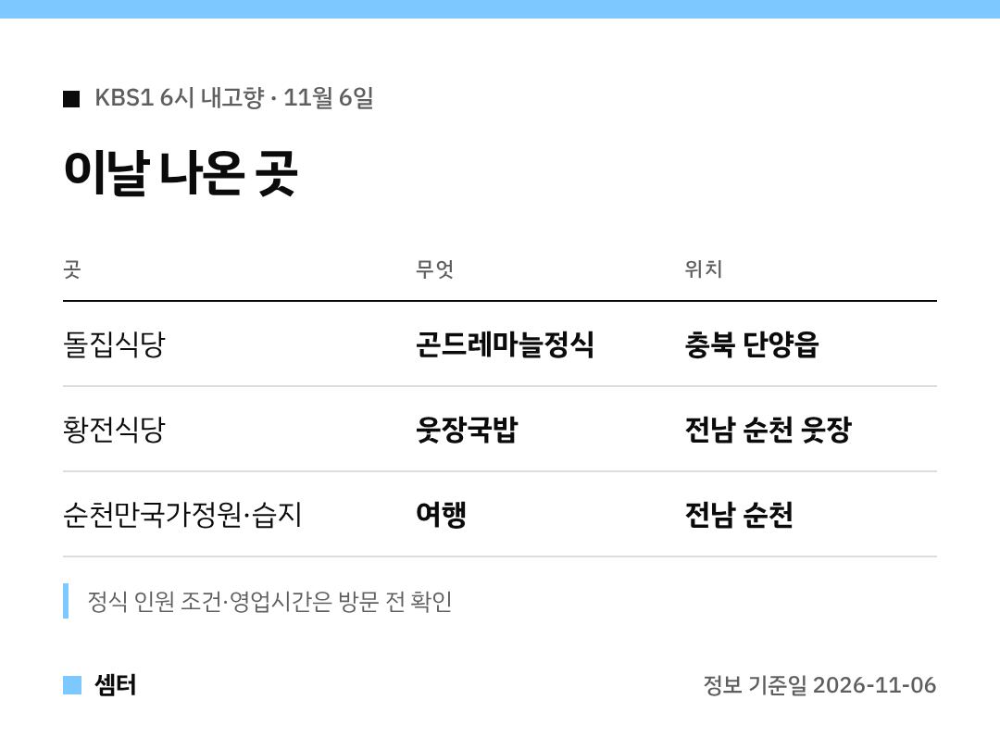

"6시 내고향에 나온 단양 마늘 정식 거기 어디예요?" 하신 분들 바로 정리했어요 🙂

## 단양 마늘 정식 집
충북 단양읍 '돌집식당'이에요.
곤드레와 흑마늘을 곁들인 정식이 대표 메뉴래요.

[📍 돌집식당 지도](https://map.naver.com/p/search/%EB%8B%A8%EC%96%91%20%EB%8F%8C%EC%A7%91%EC%8B%9D%EB%8B%B9)

## 순천 국밥 집
순천 웃장국밥거리 쪽 '황전식당'이 나왔어요.
시장 구경하고 국밥 한 그릇, 생각만 해도 든든하죠~

[📍 황전식당 지도](https://map.naver.com/p/search/%EC%88%9C%EC%B2%9C%20%ED%99%A9%EC%A0%84%EC%8B%9D%EB%8B%B9)

## 같이 들를 곳
순천만국가정원, 순천만습지, 순천전통야생차체험관이 순천 코스로 소개됐어요.
습지 갈대가 예쁠 때라 늦가을 나들이로 좋겠어요!

[순천만국가정원 지도](https://map.naver.com/p/search/%EC%88%9C%EC%B2%9C%EB%A7%8C%EA%B5%AD%EA%B0%80%EC%A0%95%EC%9B%90)

다들 든든하게 챙겨 드시구! 오늘도 좋은 하루 보내세요~ㅎㅎ
