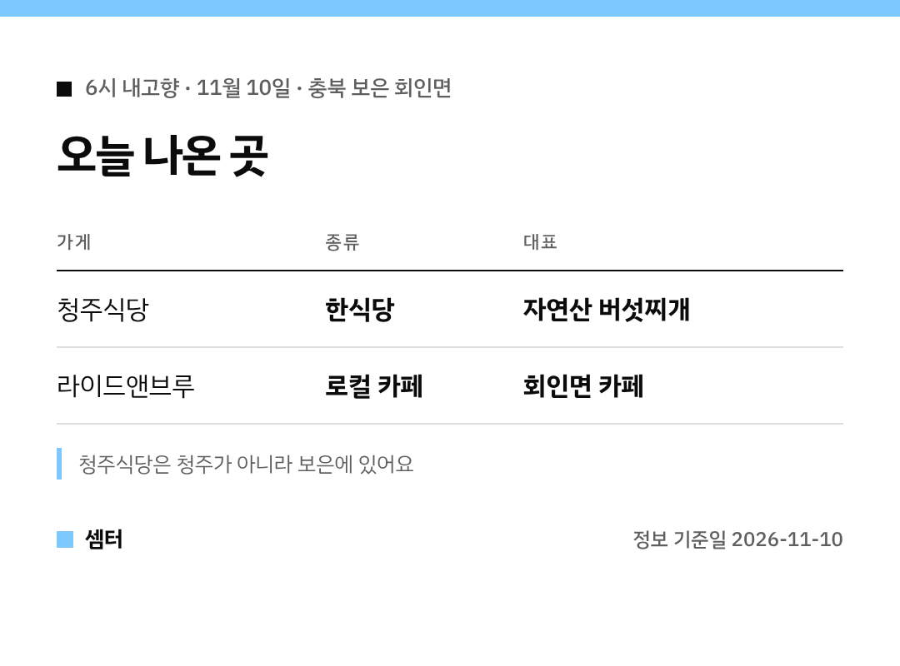

"6시 내고향 버섯찌개 거기 어디야?" 궁금하셨죠 🙂
보은 회인면 두 곳을 표로 정리했어요.

## 청주식당
회인면 중앙리 한식당이에요.
화려한 상차림보다 제철 재료로 집밥 같은 한식을 낸대요.

자연산 버섯찌개가 대표고, 닭볶음탕·토끼탕·백숙·비빔밥도 있어요.

[📍 청주식당 지도](https://map.naver.com/p/search/%EB%B3%B4%EC%9D%80%20%ED%9A%8C%EC%9D%B8%EB%A9%B4%20%EC%B2%AD%EC%A3%BC%EC%8B%9D%EB%8B%B9)

## 라이드앤브루
같은 회인면에 있는 카페예요.
밥 먹고 들르기 좋아요 😊

[📍 라이드앤브루 지도](https://map.naver.com/p/search/%EB%B3%B4%EC%9D%80%20%EB%9D%BC%EC%9D%B4%EB%93%9C%EC%95%A4%EB%B8%8C%EB%A3%A8)

다들 따뜻한 한 끼 하시구! 오늘도 좋은 하루 보내세요~ㅎㅎ
