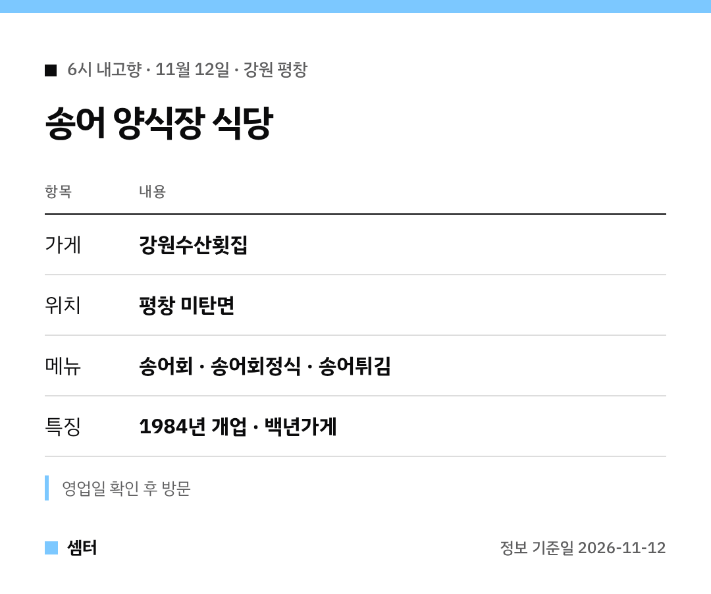

"6시 내고향 송어회 집 어디야?" 하신 분들 🙂
표로 먼저 보여 드릴게요.

## 양식장이 바로 식당
강원수산횟집은 송어를 직접 키우는 양식장 식당이에요.
알을 받아 부화시켜 성어로 키우는 방식이래요.

그래서 식당에선 직접 양식한 송어만 쓴대요.

## 오래된 집
1984년에 문을 열었고 백년가게 인증도 받았어요.
대를 이어 운영하는 곳이래요 😊

## 주소
강원 평창군 미탄면 송어길 30-4

[📍 지도에서 보기](https://map.naver.com/p/search/%ED%8F%89%EC%B0%BD%20%EA%B0%95%EC%9B%90%EC%88%98%EC%82%B0%ED%9A%9F%EC%A7%91)

다들 맛있는 하루 보내시구! 오늘도 좋은 하루 보내세요~ㅎㅎ
