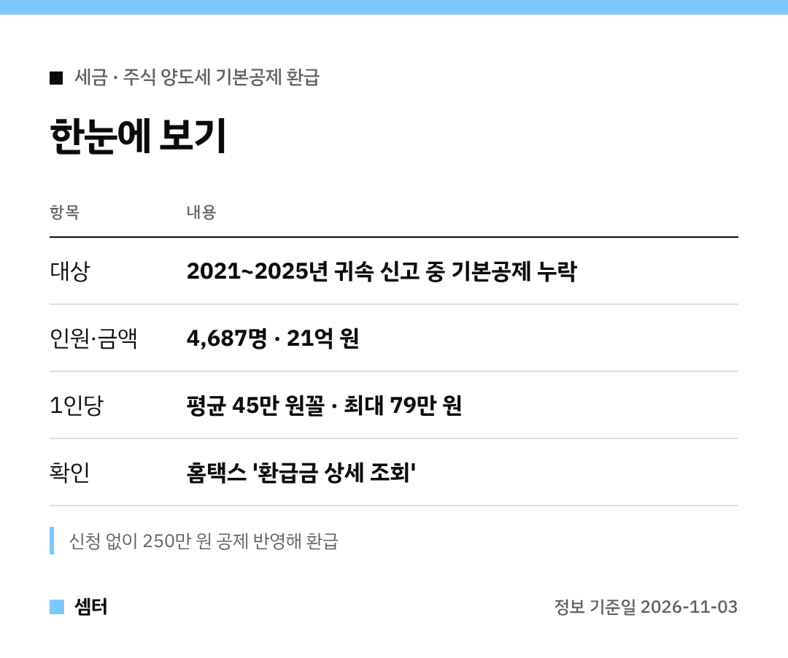

"양도세 신고할 때 250만 원 공제가 있었다고요?" 하시는 분들 꽤 있을 거예요ㅎㅎ
그 공제를 빼먹은 분들에게 국세청이 세금을 돌려줬어요 🙂

## 누가 받았어요?
2021~2025년 귀속 주식 양도소득세를 신고하면서 **기본공제 250만 원**을 넣지 않은 분들이에요.
모두 4,687명, 금액은 21억 원이래요.

평균은 1인당 45만 원꼴이고, 최대 79만 원까지 돌려받았어요.

## 따로 신청해야 해요?
아니요!
국세청이 신고 내용을 직접 보고 빠진 공제를 반영해서 **알아서 환급**했대요.

## 3분 확인 순서
- 홈택스나 손택스에 로그인
- '환급금 상세 조회'에서 받은 돈·못 받은 돈 확인
- 계좌가 없으면 같은 화면에서 '지급신청' → 본인 계좌 입력

환급계좌를 미리 등록해 둔 분은 신청 없이 바로 입금돼요.

## 다음 신고 땐 이것만 기억
국내주식은 반기별 예정신고, 해외주식이나 손익 통산은 확정신고예요.
신고서 쓸 때 **기본공제 250만 원** 칸을 꼭 확인하세요!

다들 꼼꼼하게 챙기시구! 오늘도 좋은 하루 보내세요~ㅎㅎ
