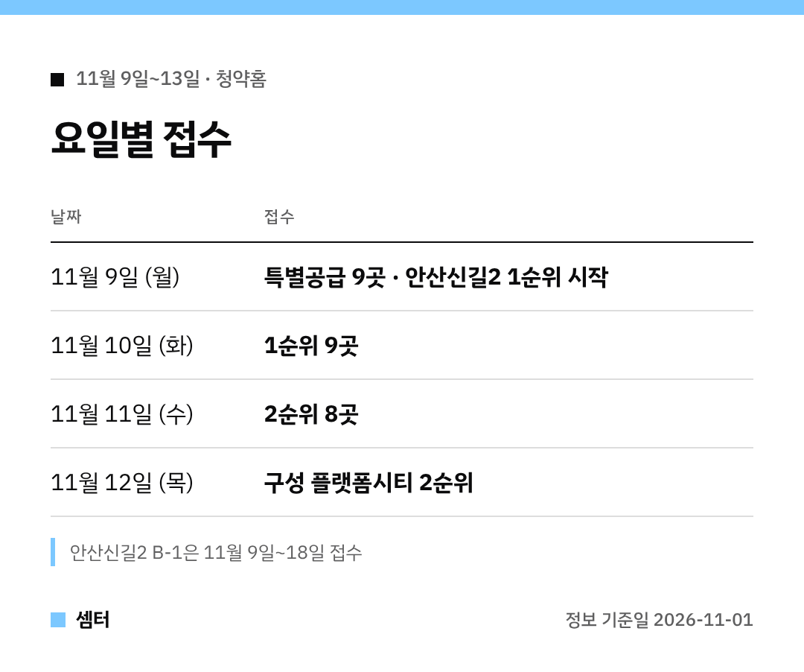

청약 준비하시는 분들~ 다음 주 달력 미리 펴 볼까요? 🙂
11월 9일부터 청약홈 접수 단지가 **10곳**이에요.

모든 날짜는 청약홈 공고 그대로예요.
신청 전엔 꼭 공고문으로 한 번 더 확인해 주세요!

## 11월 9일 월요일: 특별공급 몰린 날
민간 단지 **9곳**의 특별공급이 이날 접수돼요.
안산신길2지구 B-1 공공분양(본청약)도 이날부터 **11월 18일**까지 접수가 시작돼요.

## 11월 10일 화요일: 1순위
남춘천 센트레빌, 광교 A17 두 공고, 형곡 센트럴 아테라, 평택 고덕 우미 린, 구리갈매 신안인스빌, 엘리프 시흥, 한화포레나 지제역, 구성 플랫폼시티까지 **1순위 9곳**이에요.

## 11월 11일 수요일: 2순위
구성 플랫폼시티를 뺀 **8곳**의 2순위 날이에요.
구성 플랫폼시티 2순위는 하루 늦은 **11월 12일**이에요.

## 당첨자 발표 달력
| 날짜 | 발표 |
|---|---|
| 11월 17일 | 남춘천 센트레빌 · 광교 A17 공공분양 · 형곡 센트럴 아테라 · 평택 고덕 우미 린 · 구리갈매 · 엘리프 시흥 |
| 11월 18일 | 광교 A17 지분적립형 · 한화포레나 지제역 · 구성 플랫폼시티 |
| 11월 30일 | 안산신길2 B-1 공공분양 |

## 규모로 보면
가장 큰 곳은 **한화포레나 지제역 1098세대**, 가장 작은 곳은 **구성 플랫폼시티 76세대**예요.
10곳을 합치면 **3,700세대**랍니다.

## 이번 주 체크 포인트
- 광교 A17은 **공공분양**과 **지분적립형**이 따로 공고됐어요. 원하는 쪽 공고를 확인하세요.
- 안산신길2는 접수 기간이 길지만, 발표는 **11월 30일**로 늦어요.
- 분양가·자격은 단지마다 달라요. 공고문 필수!

다들 좋은 결과 있으시길 바라요~ 오늘도 좋은 하루 보내세요~ㅎㅎ
