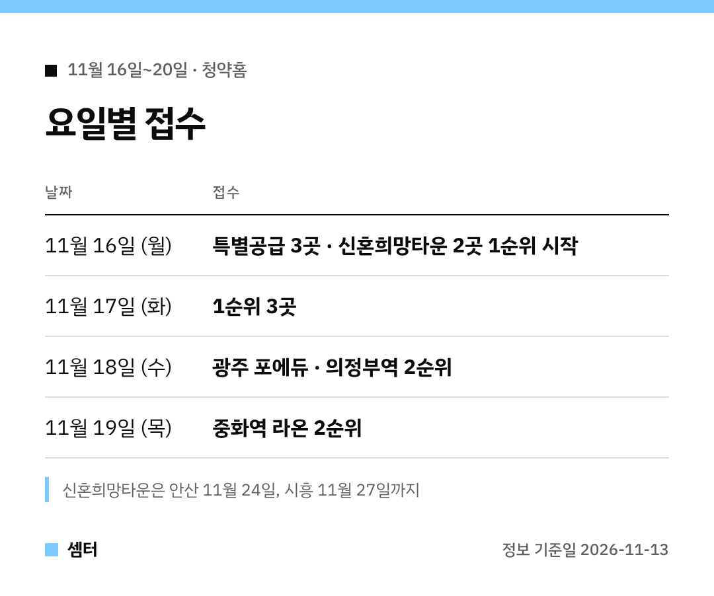

청약 준비하시는 분들~ 다음 주 달력 같이 펴 볼까요? 🙂
11월 16일부터 청약홈 접수 단지가 **5곳**이에요.

모든 날짜는 청약홈 공고 그대로예요.
신청 전엔 꼭 공고문으로 한 번 더 확인해 주세요!

## 11월 16일 월요일: 시작하는 날
민간 단지 **3곳**(광주 포에듀, 의정부역 펠리스타워, 중화역 라온)의 특별공급이 이날이에요.
신혼희망타운 **2곳**도 이날 1순위 접수를 시작해요.

## 11월 17일 화요일: 민간 1순위
제일풍경채 광주 포에듀, 의정부역 펠리스타워 양우내안애, 중화역 라온프라이빗 센트로까지 **1순위 3곳**이에요.

## 11월 18일 수요일 · 19일 목요일: 2순위
광주 포에듀와 의정부역은 **11월 18일**, 중화역 라온은 **11월 19일**이 2순위예요.

## 당첨자 발표 달력
| 날짜 | 발표 |
|---|---|
| 11월 24일 | 제일풍경채 광주 포에듀 · 의정부역 펠리스타워 양우내안애 |
| 11월 25일 | 중화역 라온프라이빗 센트로 |
| 12월 4일 | 안산신길2 A-6 신혼희망타운 |
| 12월 8일 | 시흥 거모 아테라 A-6 신혼희망타운 |

## 규모로 보면
가장 큰 곳은 **제일풍경채 광주 포에듀 572세대**, 가장 작은 곳은 **중화역 라온프라이빗 센트로 113세대**예요.
5곳을 합치면 **1,830세대**랍니다.

## 접수 당일 순서
청약홈에 인증서로 로그인하고, 단지를 고른 다음 공급 유형(특별공급·일반공급)을 선택해요.
주택형과 거주 지역을 고르고 나면 마지막 확인 화면이 나와요.

접수가 끝나면 '청약 신청 내역'에서 다시 한 번 확인할 수 있어요.
마감 시간에는 접속이 몰릴 수 있으니 여유 있게 들어가세요~

## 이번 주 체크 포인트
- 서울 단지는 **중화역 라온프라이빗 센트로** 한 곳이에요.
- 신혼희망타운 2곳은 접수가 길어요(안산 **11월 24일**, 시흥 **11월 27일**까지).
- 분양가·자격은 단지마다 달라요. 공고문 필수!

다들 좋은 결과 있으시길 바라요~ 오늘도 좋은 하루 보내세요~ㅎㅎ
