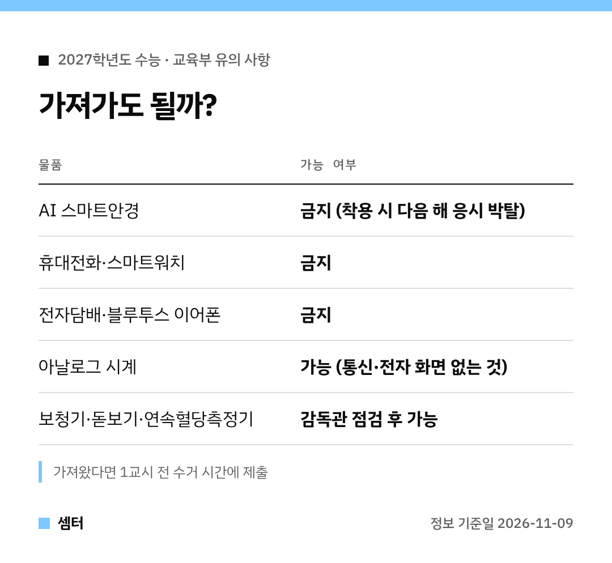

수능 전날 가방 챙기다가 "이거 가져가도 되나?" 헷갈리시죠 🙂
교육부 유의 사항으로 체크리스트를 만들어 봤어요.

## 올해 달라진 점
가장 눈에 띄는 건 AI 스마트안경이에요.
시험 중 쓰고 있다가 걸리면 다음 해 수능 응시 자격까지 잃어요.

계획적으로 스마트안경을 써서 부정행위를 하면 형사처벌까지 갈 수 있게 고발·수사 의뢰를 하겠대요.
감독관이 스마트기기를 확인하면 협조해야 해요.

## 아침 체크
- 입실: 오전 8시 10분까지
- 신분증: 사진 붙은 유효기간 내 실물 (모바일 X)
- 수험표: 선택과목·시험장 위치 미리 확인

수험표를 잃어버렸으면 사진 1장과 신분증을 들고 오전 8시까지 시험 관리본부로 가세요.

## 전자기기를 들고 왔다면
1교시 전에 반입금지 물품을 걷는 시간이 있어요.
그때 감독관 지시대로 내면 시험 끝나고 돌려받아요.

계속 갖고 있다가 적발되면 부정행위, 시험 무효예요.

## 4교시가 제일 위험해요
한국사를 안 보면 성적표 전체가 안 나와요.
탐구는 고른 순서대로, 해당 과목 문제지만 올려 두기!

제1선택 시간이 끝난 뒤 그 답을 고치면 부정행위예요.

## 마킹과 가채점
답안·필적확인문구 모두 검은색 컴퓨터용 사인펜으로 써요.
수험표 뒤 가채점표는 매 교시 종료령 전까지만 적을 수 있어요.

종료령이 울리면 바로 펜을 내려놓고 감독관 지시를 따르세요 😊

모두 후회 없는 하루 보내시구! 오늘도 좋은 하루 보내세요~ㅎㅎ
