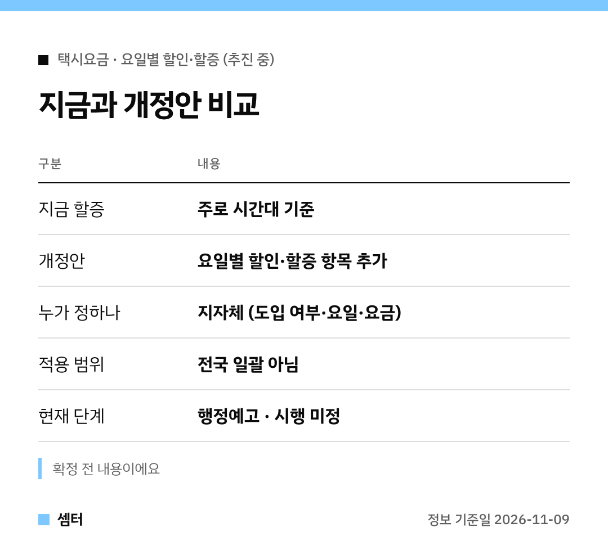

"주말엔 택시비가 더 나오는 거야?" 이런 얘기 들으셨죠?
궁금하신 분들 위해 짧게 정리해 봤어요 🙂

결론부터 말하면 아직은 **추진 단계**예요.
요금이 정해진 지역은 한 곳도 없어요.

## 바뀌는 규정
대상은 국토부 훈령 '여객자동차 운송사업 운임·요율 등 조정요령'이에요.
지자체가 정할 수 있는 운임 세부 항목에 요일별 할인·할증을 더하는 개정안이 행정예고됐어요.

지금 택시 할증은 대부분 시간대를 기준으로 붙어요.
여기에 요일이라는 기준이 하나 더 생길 수 있는 거죠~

## 왜 요일인가요?
수요가 몰리는 날 택시가 모자라서예요.
금요일·주말처럼 붐비는 날 요금을 올리면 운행하는 택시가 늘 거라는 계산이에요.

거꾸로 한가한 요일엔 할인을 해 줄 수도 있어요 😊

## 결정은 지자체 몫
이 제도는 전국에 똑같이 적용되지 않아요.
지자체가 그 지역 택시 수급을 보고 결정해요.

정하는 건 세 가지예요.
도입 여부, 적용 요일, 요금 수준이에요.

## 알아 둘 점
- 지금 내는 택시요금은 그대로예요
- 시행 여부·요일·금액은 아직 미정이에요
- 우리 지역 적용은 시·도가 따로 정해야 해요

전문가 사이에선 서비스 개선 기대와 소비자 부담 우려가 함께 나왔어요.
시간 할증에 요일 할증까지 더해지면 부담이 커질 수 있다는 거예요.

다들 편하게 이동하시구! 오늘도 좋은 하루 보내세요~ㅎㅎ
