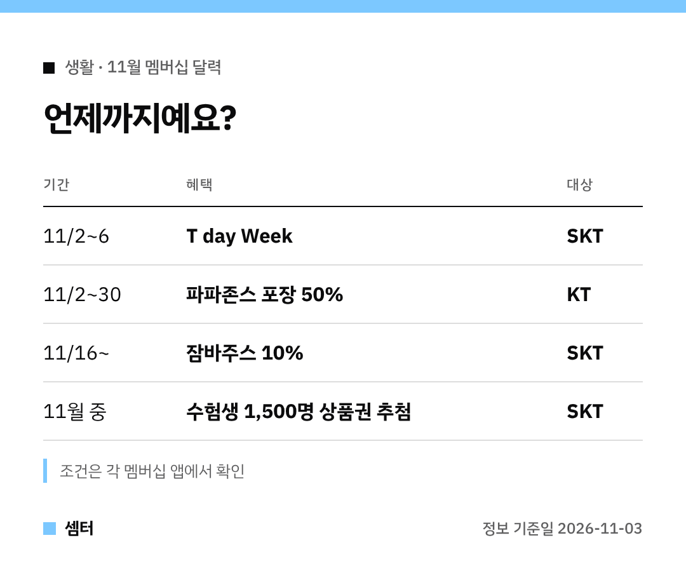

멤버십 할인은 날짜 놓치면 끝이잖아요~
그래서 이번엔 **끝나는 날 순서**로 정리해 봤어요 🙂

## 제일 급한 것: T day Week (11월 6일까지)
SKT T 멤버십 T day Week가 11월 2일에 시작해 6일에 끝나요.
배달의민족, 던킨, 쉐이크쉑, 파리바게뜨, 29CM, 숨고가 들어 있어요.

## 한 달 내내: KT 파파존스 방문 포장 50%
KT 멤버십 달달혜택이에요.
11월 30일까지, 1만~5만 원 주문이면 피자·사이드·음료(2잔까지) 모두 반값이래요!

다만 달달혜택은 **모든 브랜드 합쳐 월 1회**예요.
다른 쿠폰이나 세트 메뉴와 같이 쓸 수 없는 점도 기억해 두세요.

## 11월 16일부터: 잠바주스 10%
잠바주스가 T 멤버십 새 제휴사로 들어와요.
전 메뉴 10% 할인이에요.

## 수험생 있는 집이라면
2027학년도 수능 보는 SKT 고객은 응모하면 추첨으로 상품권을 받을 수 있어요.
올리브영·다이소·컬쳐랜드 2만 원권, 모두 1,500명이래요.

만 13~34세는 Young Week로 도미노피자 포장 50%, 이마트24 빼빼로 50% 같은 혜택도 받아요 😊

## 연말 여행 계획 있다면
baro 요금제를 쓰면 클럽 T 로밍으로 데이터 1GB 무료 충전, 공항버스·면세점 할인이 있어요.
혜택은 각각 월 1회고, 귀국 후 혜택도 하나 골라 받을 수 있대요.

## 그 밖에
광고 수신 동의 고객 3,000명에게 롯데시네마 관람권 추첨, 고향사랑기부제 참여 시 최대 10% 추가 혜택도 있어요.

다들 날짜 놓치지 마시구! 오늘도 좋은 하루 보내세요~ㅎㅎ
