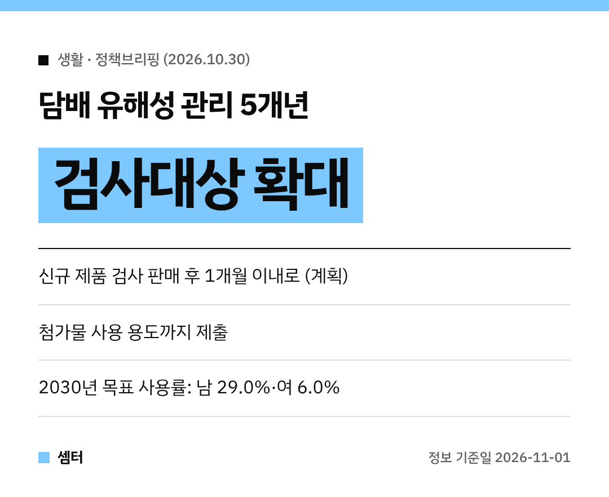

"전자담배는 덜 해롭다던데?"
이런 이야기 한 번쯤 들어 보셨죠~

그래서 정부가 **어떤 성분이 들었는지부터 제대로 검사하겠다**는 계획을 내놨어요 🙂

## 무슨 계획이에요?
보건복지부와 식품의약품안전처가 **지난 29일** 확정한 **제1차 담배 유해성 관리 기본계획(2027~2031)**이에요.
2025년 11월 담배유해성관리법이 시행된 뒤 처음 세운 5년 계획이래요.

## 1. 검사받는 담배가 늘어요
지금까지 빠져 있던 **무연담배, 엽궐련, 물담배**까지 검사대상이 돼요.
검사 항목도 궐련·궐련형은 **44종 → 50여 종**, 액상형은 **20종 → 30여 종**으로 2030년까지 늘린대요.

## 2. 새 제품은 바로 검사
신제품 검사 의뢰 시기를 **판매 시작 후 1개월 이내**로 앞당길 계획이에요.
지금보다 최대 **17개월** 빨라진대요.

## 3. 첨가물도 들여다봐요
제조·수입업자는 첨가물 **사용 용도**까지 제출해야 하고, 불시 현장점검도 받아요.
맛과 향을 내는 첨가물 중 일부는 **단계적 사용 금지 방안**까지 검토한다고 해요.

## 4. 정보도 공개 예정
유해성분 **정보공개 방안**을 만들고, 관리 대상 데이터도 2029년엔 무연담배·시가까지 넓힌대요.

## 숫자로 보는 배경
- 담배 연기 속 발암물질 **70종 이상**
- 2023년 직접 흡연 사망자 **6만 8536명**
- 2025년 성인 담배제품 사용률 **남성 36.3%, 여성 8.6%**

다 같이 건강한 공기 마시는 날이 오길 바라요~
다들 오늘도 건강한 하루 보내세요~ㅎㅎ
