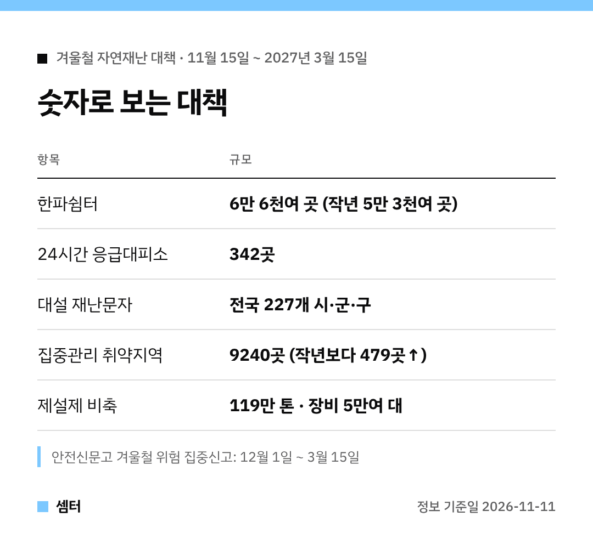

올겨울 정부 대설·한파 대책, 숫자만 쏙 뽑아 봤어요 🙂

## 기간
겨울철 자연재난 대책기간은 11월 15일부터 2027년 3월 15일까지예요.
이 기간엔 24시간 상황관리 체계가 돌아가요.

## 쉼터와 대피소
한파쉼터가 작년보다 1만 곳 넘게 늘었어요.
24시간 운영하는 응급대피소도 342곳 있어요.

쪽방주민·노숙인을 위한 응급잠자리는 217곳이에요.

## 눈 대비
제설제는 작년 사용량의 126% 수준인 119만 톤을 쌓아 둔대요.
제설장비도 5만여 대 확보한다고 해요.

결빙 구간, 고립 예상 지역 같은 취약지역 9240곳을 따로 집중 관리해요.

## 알림 받는 법
- 대설 재난문자: 전국 227개 시·군·구
- 도로 살얼음: 내비게이션 앱·도로전광표지판
- 한파특보: 재난문자·TV 자막
- 외국인: '이머전시 레디' 앱

## 내가 할 수 있는 것
12월 1일부터 안전신문고로 제설 안 된 곳을 신고할 수 있어요.
눈 오는 날엔 대중교통, 내 집 앞 눈은 직접 치우기 😊

다들 건강하게 겨울 나시구! 오늘도 좋은 하루 보내세요~ㅎㅎ
