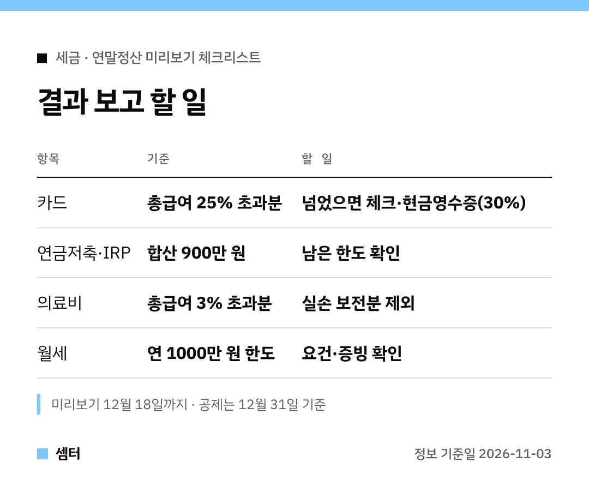

미리보기 결과 화면, 숫자만 보고 닫으신 적 있죠?ㅎㅎ
결과를 보고 **남은 두 달 동안 뭘 하면 되는지**를 항목별로 묶어 봤어요 🙂

## 먼저: 미리보기는 12월 18일까지
홈택스 연말정산 미리보기는 12월 18일까지 쓸 수 있어요.
올해 예상 소득·지출로 내년 1월 예상 세액을 미리 계산해 주는 서비스예요.

결과는 예상치라서 실제와 다를 수 있다는 점은 감안하세요!

## 카드 사용액이 25%를 넘었다면
카드 공제는 총급여의 25%를 넘긴 부분부터 계산돼요.
이미 넘었다면 남은 기간은 공제율 30%인 체크카드·현금영수증을 쓰는 게 좋아요.

아직 못 넘었다면 공제율(신용 15%)보다 카드 혜택을 따지는 편이 나아요.

## 연금저축·IRP 한도가 남았다면
연금저축 600만 원, IRP 합산 900만 원까지 세액공제가 돼요.
남은 한도를 확인하고, 중도 해지 부담까지 생각해서 넣으세요.

## 병원비를 꽤 썼다면
의료비는 총급여의 3%를 넘은 금액부터예요.
실손보험금으로 돌려받은 건 빼고 계산해야 해요.

## 월세를 낸다면
무주택 등 요건을 맞추면 연 1000만 원 한도로 15% 또는 17%를 돌려받아요.
계약서와 납부 증빙을 미리 챙겨 두세요.

## 올해 새로 바뀐 것
자녀 등 직계비속 교육비는 소득요건이 없어졌어요.
고향사랑기부는 10만 원 초과~20만 원 이하 구간이 40% 세액공제로 바뀌었고요.

대부분 공제는 12월 31일까지 쓴 돈 기준이니, 연말 전에 정리해 두면 마음 편해요~

다들 꼼꼼하게 챙기시구! 오늘도 좋은 하루 보내세요~ㅎㅎ
